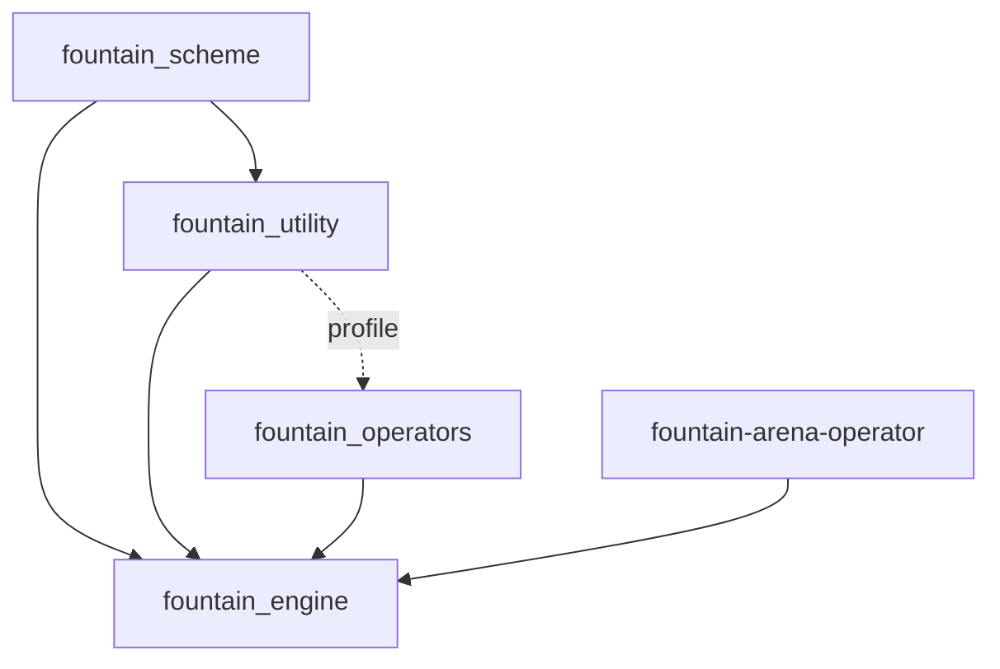
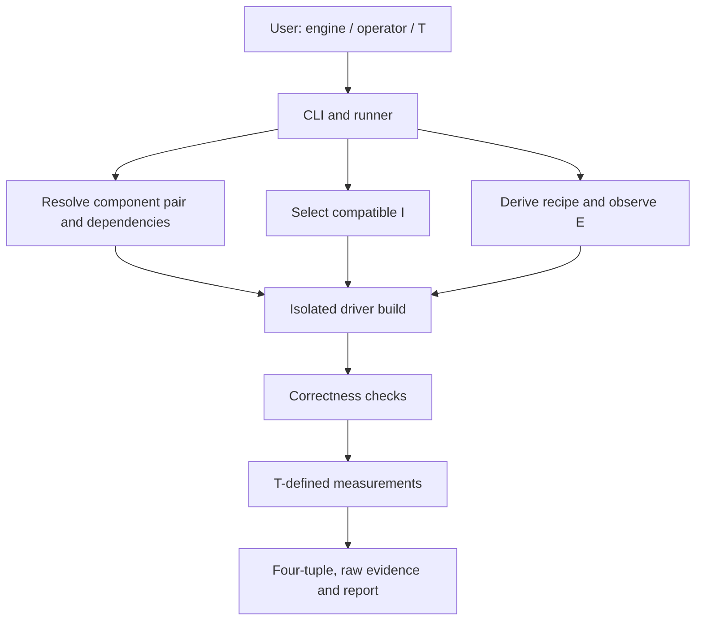

# Fountain evaluation architecture

Status: agreed architecture with a single-package scaffold. Updated 2026-11-01.

## 1. Public workflow

A user selects exactly two tested components, **engine** and **operator**, plus a **test content version**. Arena, Slab, and Simd are operator implementations.

```text
fountain-eval run --engine <reference> --operator <reference> --test <name@version>
```

The framework selects the native interface implementation and derives the experiment recipe. Users do not supply interface versions, scheme/utility components, target manifests, or arbitrary experiment parameters for a standard run.

Currently, the executable parses requests and inspects local Cargo declarations. It has no registered interfaces or tests. The README documents implemented commands; the execution pipeline below describes the intended architecture.

## 2. Four-tuple model

Resolved experimental conditions are **`(C, I, T, E)`**.

| Dimension | Meaning | Selection |
|---|---|---|
| C: component pair | Engine and operator under test | User selects references; framework records actual source identities and dependency closure |
| I: interface implementation | Native API binding, conversions, capability mapping, interface-specific dependencies | Automatically selected immutable compatible implementation |
| T: test content | Scenarios, parameters, lifecycle, timing/validation/statistical semantics, assets and implementations affecting those semantics | User selects an immutable version |
| E: effective configuration | Expanded recipe, build options, toolchain and actual hardware/system/execution conditions | Derived from T and validated observations |

C has two public roles. Schemes, utility libraries and support packages remain part of provenance, not additional user-selected tested components. Their versions follow registered integration rules and locked dependencies. Missing mappings cause explicit errors rather than guessing.

I and T evolve independently. There is no aggregate public protocol version and no fifth top-level axis. Repository commits, crate versions, output formats, binary digests, run IDs and report-generator revisions provide provenance. A run ID distinguishes repetitions of the same tuple, including failures and environmental observations.

## 3. Existing libraries

Observations below are pinned to section 12's source snapshots.

| Library | Role | Consequence |
|---|---|---|
| `fountain_engine` | Encoder, Decoder, solver, DataManager; owns DataOperator, CodeScheme, Operation and HDPC/LDPC interfaces | Native APIs and Rust type identity depend on engine version |
| `fountain_scheme` | R10, RQ, LT, BHP and related scheme/precode parameters | Support dependency on engine/utility; T chooses schemes |
| `fountain_utility` | Padding, EncodingPlan, repair emitter, reference operator and test utilities | Runtime support changes affect provenance and attribution |
| `fountain_operators` | Slab/Simd implementations, GF kernels, storage and tooling | Operator package depending on engine |
| `fountain-arena-operator` | Arena storage and CPU/runtime arithmetic backends | Operator currently requiring exact public engine 2.1.0 |

The monorepo snapshot labels its engine `3.0.0-dev`. Public engine 2.1 is a separate integration target. This package-level dependency diagram does not imply arbitrary revisions link together; dashed edges are optional and development dependencies are omitted.



The product path includes `fountain_bin_ffi`, `fountain_engine_sys` bindings and RQ/R10 facades. Product symbol callbacks expose read/write and optional XOR/copy operations, not the full source DataOperator interface. Product integrations must identify this execution path explicitly. The two-component model still applies to the engine product and supported operator implementation.

## 4. One package, internal modules

`fountain-eval` is one Cargo package with a library and CLI. Internal modules provide responsibility boundaries; protocol, runner and CLI are not separately published crates.

```text
fountain_eval/
├── Cargo.toml / Cargo.lock / rust-toolchain.toml
├── src/
│   ├── lib.rs              library entry point
│   ├── main.rs             CLI
│   ├── protocol.rs         independent request/inspection models
│   └── runner.rs           offline declaration inspection
├── tests/                  framework checks
├── specs/                  protocol and identity boundaries
├── suites/                 future immutable T recipes
├── fixtures/               future fixed test assets
├── targets/                future maintainer-owned build recipes
├── drivers/                future native API-specific build roots
├── docs/                   internal module roadmap
└── scripts/                repository checks
```

Source resolution/building, measurement, independent reference validation and analysis become internal modules as implemented. Documentation describes their boundaries until then; no empty crates or placeholder traits are needed.

Future native drivers may require independent Cargo build roots and lockfiles to bind incompatible engine APIs or product ABIs. This does not split the public framework package or force native drivers into one engine dependency graph.



The scaffold currently stops at parsing and preliminary declaration inspection.

## 5. Cross-project integration

Components stay in their own repositories. Eval owns reference resolution and build composition, not vendored component implementations.

Current syntax covers local crate paths, exact crates.io versions and pinned HTTPS/SSH Git references with a package selector. Remote references are parsed without fetching. An optional implementation selector distinguishes operators within a package; future drivers must reject ambiguous/unsupported selections.

Future resolution preserves complete monorepo layouts and relative dependencies. Git inputs use isolated checkouts. Local development sources are frozen into temporary build-input snapshots with source identity and dirty changes recorded. Snapshots are build evidence, not source copies committed into eval. Continued edits to an original worktree cannot change a prepared execution.

The resolver generates an isolated driver build root and locks its actual dependency graph. It does not silently edit upstream manifests. The selected operator and support libraries must share compatible engine trait identities. Cargo patches select compatible sources; they cannot defeat version constraints or repair arbitrary API differences.

For example, an operator requiring `fountain_engine = "=2.1.0"` cannot automatically consume engine `3.0.0-dev`. Maintainers supply compatible revisions. Explicit experimental source/manifest adaptations must appear in provenance and attribution.

## 6. Configuration ownership

Users supply three references. Shared recipes and integration mappings are maintainer-owned. Optional local settings may locate caches or named source bindings without introducing hidden workload/compiler/timing overrides.

T determines schemes, parameter combinations, input/receive generation, seeds, initialization/cache modes, warmups, repeats, scheduling, statistics and build/environment requirements. E records the full expansion. I converts native parameters while preserving those meanings.

The host cannot be derived from T. The framework observes effective toolchain, hardware, OS and execution conditions, then validates them against the recipe. Equal T on different hosts does not imply equal E. Dynamic observations qualify run validity without turning every incidental observation into a manually selected parameter.

Global Cargo settings, environment build flags and other effective overrides must be controlled or recorded. Credentials remain outside experiment files. Standard execution does not accept arbitrary workload overrides under an unchanged recipe.

The complete configuration is a generated artifact, not a form for each developer. Support dependency resolution, private-source access and build failures remain explicit.

## 7. Stable boundaries and version ownership

| Boundary | Stable meaning | Owner |
|---|---|---|
| Component selection | Engine/operator references and implementation selection | Request format; resolved components are C |
| Native API binding | Constructors, methods, argument/status conversions and capabilities | I |
| Workload/workflow | Task, parameters, lifecycle, required outputs and validation | T |
| Timing/metrics | Included work, endpoints, units and statistics | T |
| Execution conditions | Recipe plus actual build/runtime conditions | E |
| Evidence | Original identities, raw observations, failures and provenance | Output format |

Each I publishes the minimal native API surface it consumes. There is no single engine trait: integration can use Encoder/Decoder methods, DataOperator, CodeScheme, configurations, operations and statuses. Compatible behavior matters alongside signatures.

Internal layout, SIMD, solvers, operation counts, matrix representation, fusion and native scheduling may evolve in C. An operator-trace test fixes its trace input; an engine optimization may legitimately generate a different trace.

Renaming a constructor or mapping an equivalent status updates I. Moving initialization outside timing, changing output materialization or changing a requested execution mode affects T. Internal dispatch improvements under unchanged requested session semantics belong to C.

Published I/T identities are immutable. Equivalent API adaptation can update I without changing T. Measurement/validation fixes affecting results update the relevant identity and identify affected historical results. Report presentation may evolve independently; metric/statistical semantics belong to T.

The CLI crate version and inspection JSON format version are development metadata. This scaffold publishes no I or T release.

## 8. Conflicts and correctness

Explicit conflicts fail before formal evaluation: invalid/unavailable references, dependency constraints, native type identity, build failures and missing capabilities. The scaffold detects syntax, local manifest errors and some unconditional engine version mismatches only.

Correctness validation checks implicit semantic conflicts against T-defined independent evidence. A pass covers those scenarios, not every possible defect. Failed validation does not yield valid performance conclusions.

Reference validation is independent of the tested implementation. Existing utility operators may be comparison subjects or integration aids; their names do not make them the sole authority. Private-source access does not authorize upstream writes or publication.

## 9. Comparability and attribution

For valid runs with the relevant correctness checks passed, **equal T and E plus equivalent I semantics permit comparison across different C values. I versions need not match.**

Equivalent integration preserves inputs, parameter meaning, task/mode, lifecycle, required outputs, timing and validation. It introduces no undeclared precomputation, caching or transfer of work outside measurement. Real bridging costs inside the measured path remain included. Internal algorithms and operation sequences may differ.

Maintainers verify and record I/T compatibility, including capability/configuration limits. Users need not audit adapter code manually. Selection resolves to an immutable verified implementation, not a floating branch.

| Change | Direct conclusion |
|---|---|
| One tested component changes; I/T/E fixed | Effect of that component, after checking dependency differences |
| Both components or support dependencies change | Effect of the recorded combination |
| C and I change; T/E match and I semantics are equivalent | Effect of the component and integration path together |
| I equivalence is unverified | Direct comparability is not established |
| T or E changes | Different methods/conditions; requires further equivalence evidence or a shared-condition rerun |

A baseline is a fixed component pair, not a reused historical number. Paired comparisons rerun both sides under the same T/E with compatible I. Historical identities and failures are preserved; reanalysis creates a separate record without relabeling execution.

## 10. Evidence and lifecycle

Future runs record the four-tuple, complete dependency/build evidence, binary digests, environment observations, validation, raw samples and comparison limits. Unavailable, unsupported, failed, unexecuted and successful outcomes are distinct. Missing timings cannot become zero-valued measurements.

Prepared inputs are immutable. Each repeated execution receives a new run ID and retains earlier attempts. Inputs are not silently refreshed during execution. Cache/result retention policies must be defined before real runs; completion alone does not authorize long-term publication or archival.

Inspection currently produces no resolved I/E, source snapshot identity or performance samples and cannot substitute for an evaluation record.

## 11. Next implementation boundaries

The current package implements reference parsing, local declaration inspection, structured diagnostics and explicit execution-unavailable behavior.

Next work defines real T recipes, native I catalogs and semantic equivalence checks, then implements source snapshots/resolution, isolated builds, environment validation, correctness, timing, evidence and comparisons. Artifact access/retention/publication rules precede real runs. These capabilities extend internal modules; native-driver build roots are introduced only when integration needs isolation.

## 12. Source basis

Architectural observations use fixed snapshots:

- `shhyang/erasure_coding_lib` at `2b603359f883448d257ec7c5401fc8a9b4054621`: [workspace](https://github.com/shhyang/erasure_coding_lib/blob/2b603359f883448d257ec7c5401fc8a9b4054621/Cargo.toml), [DataOperator](https://github.com/shhyang/erasure_coding_lib/blob/2b603359f883448d257ec7c5401fc8a9b4054621/fountain_engine/src/traits/data_operator.rs), [CodeScheme](https://github.com/shhyang/erasure_coding_lib/blob/2b603359f883448d257ec7c5401fc8a9b4054621/fountain_engine/src/traits/code_scheme.rs), [product integration](https://github.com/shhyang/erasure_coding_lib/blob/2b603359f883448d257ec7c5401fc8a9b4054621/product/README.md). Links require private upstream access.
- `Gideon-0709/fountain-arena-operator` at `d777cad6b512ee17663e129512bae10bca3397b1`: [dependency declaration](https://github.com/Gideon-0709/fountain-arena-operator/blob/d777cad6b512ee17663e129512bae10bca3397b1/Cargo.toml).

This repository contains architectural observations and references, not copies of private upstream source.
