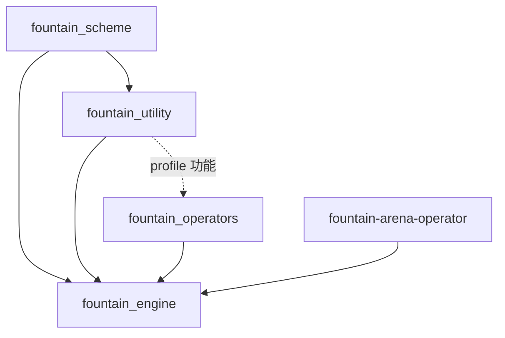
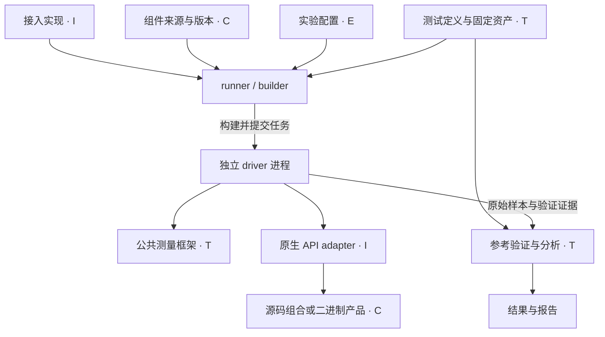

# fountain_eval 架构与版本设计

设计状态：团队已确定的架构边界；实现尚未开始。

记录日期：2026-11-01。

本文固定四元组模型、职责与依赖方向、版本边界和可比性规则。目录、模块和协议对象名称用于表达设计职责，具体 crate 划分、文件 schema、版本编号格式和命令行将在实现设计阶段确定。本文本身的 Git revision 是设计记录，不代表已经发布了某个 I 或 T 版本。

## 1. 使用者要完成的任务

开发者指定被测组件及基线，选择测试版本和实验配置，使用兼容的接入实现执行测试。框架记录完整的构建与运行证据，并给出结果、可比性判断和结论的归因范围。

团队使用的实验条件模型为：

**实验条件 = `(C, I, T, E)`**。

| 维度 | 定义 | 使用者与框架的分工 |
|---|---|---|
| C：组件版本集合 | 被测 engine、scheme、operator、utility 及实际参与运行的依赖版本 | 开发者指定候选与基线；框架解析并记录完整依赖 |
| I：测试接入版本 | 将测试请求绑定到组件公共 API 的实际适配实现、类型转换和能力映射 | 维护者提供兼容接入；框架解析后明确记录所用版本 |
| T：测试版本 | 测试内容与流程、计时边界、指标与统计口径、验证规则、固定测试资产及影响这些行为的公共实现 | 团队共同定义；维护者发布不可变版本 |
| E：实验配置 | 用例参数、输入选择、seed、模式选择、构建选项、工具链、硬件、系统和执行环境 | 使用者选择配置；框架补全解析结果并核验实际环境 |

I 和 T 独立迭代，分别具有不可变身份。仓库整体 revision、内部模块版本和产物摘要用于追溯，不增加第五个一级维度。对外不再以一个组合发布号替代 I 和 T。

四元组标识条件，同一四元组允许多次执行。每次执行另有运行编号、时间、执行顺序、环境观测和原始样本。这些信息用于区分重复测量、解释波动和核验有效性。

## 2. 现有 Fountain 库的职责与依赖

### 2.1 源码组件

以下结构以文末固定的源码快照为依据。该 monorepo 的 engine 标为 `3.0.0-dev`；本设计同时覆盖公开的 engine 2.1 接入路线。版本号用于描述快照，接入后续 revision 时由构建解析结果给出实际依赖。

| 组件 | 当前职责 | 主要依赖与接入影响 |
|---|---|---|
| `fountain_engine` | 定义 `DataOperator`、`CodeScheme`、`Operation`、HDPC/LDPC 接口；实现 Encoder、Decoder、DataManager 和求解器 | trait 与原生类型由 engine 提供，接入需要匹配其具体依赖身份 |
| `fountain_scheme` | R10、RQ、LT、BHP 等编码方案，参数策略、degree generator 和 precode 实现 | 正常依赖 engine 和 utility |
| `fountain_utility` | 补零包装、`EncodingPlan`、repair emitter；也包含参考操作器、操作计数、测试与 benchmark 工具 | 正常依赖 engine；`profile` 功能可引入 operators |
| `fountain_operators` | Slab、Simd、GF 内核、存储，以及轨迹和测试工具 | 正常依赖 engine；测试使用 scheme 和 utility |
| `fountain-arena-operator` | Arena 存储、CPU/运行时运算后端、原生 DataOperator 实现 | 当前正常依赖固定为公开 engine `=2.1.0`；测试使用 scheme 和 utility |

核心依赖方向如下。实线表示正常源码依赖，虚线表示可选功能依赖；图中省略 dev-dependency 和第三方库。



依赖身份不能仅由 crate 名称判断。来自不同版本或来源的 engine 可以定义不同身份的同名 trait。一个原生组合需要让 scheme、utility 和 operator 对接到兼容的 engine 类型；具体解析结果由构建检查确认。

`fountain_utility` 的运行功能属于被测组合。补零、计划回放或 repair emitter 的变化可能影响行为与性能，因此 C 必须包含其实际版本。其测试工具可以帮助迁移和诊断，正式测试定义、计时和报告语义由 fountain_eval 持有。

### 2.2 二进制产品

现有产品还包含独立路径：

- `fountain_bin_ffi` 依赖 engine、scheme 和 utility，构建带 C ABI 的产品二进制。
- `fountain_engine_sys` 提供绑定与链接；RQ/R10 Rust facade 依赖 sys 并调用二进制。
- `FeSymbolOps` / `SymbolOps` 提供符号读写，以及可选 XOR、copy 回调。

这条路径使用独立接入驱动。它可以共享完整 codec 的任务与结果协议，能力声明保留其 C ABI、facade、外部符号回调等实际路径。源码 `DataOperator` 与产品符号回调具有不同接口和能力，不能仅凭 operator 名称将它们认定为同一路径。

对于二进制产品，C 记录发布产物身份、二进制摘要及可取得的组件构建来源；I 记录绑定与适配实现；E 记录实际链接、加载及执行条件。无法取得的内部信息明确标为未知，并限制相关归因。

## 3. 独立测试仓库的模块

### 3.1 逻辑组织

下列目录表示职责划分；当前仓库只包含设计文档，不宣称这些模块已经存在。

```text
fountain_eval/
├── specs/                 行为契约、任务与结果协议、测量语义
├── suites/                版本化实验定义
├── fixtures/              固定输入、轨迹、预期结果及来源
├── targets/               被测组件组合与构建配方
├── core/
│   ├── protocol/          独立任务和结果数据模型
│   ├── runner/            计划、进程、顺序和运行状态管理
│   ├── build/             依赖解析、隔离构建、构建身份
│   ├── measurement/       公共计时与样本采集机制
│   ├── reference/         独立参考语义和验证
│   └── analysis/          可比性检查、统计和报告
├── drivers/
│   ├── rust-engine-2_1/   公开 2.1 API 系列的原生驱动
│   ├── rust-engine-3/     开发中 3.x API 系列的原生驱动
│   └── binary-product/   二进制产品驱动
└── docs/                  接入指南、版本规则和设计决策
```

各模块的版本归属按其影响划分，不能仅按目录名称判断。例如驱动中的 API 绑定属于 I，驱动执行的计时阶段规则属于 T；runner 内影响执行顺序或初始化策略的逻辑同样受 T 约束。

固定资产与实现元数据由仓库管理。构建缓存、临时源码检出、运行样本与分析中间结果使用受忽略的工作目录或专门的产物存储。具体保留与发布策略后续确定；运行完成不自动构成长期归档或公开发布授权。

### 3.2 依赖方向

下图展示任务、构建和证据流。静态代码依赖遵守图后的模块边界。



依赖边界如下：

1. 公共协议、参考模型和分析核心独立于被测 fountain 实现。它们不使用某个 engine 版本的原生类型作为跨版本事实模型。
2. driver 依赖公共协议、测量框架和对应原生组件；adapter 负责 API 绑定。
3. 原生库的生产代码不依赖 fountain_eval。各库的 CI 可以调用固定的 I、T 和 E 执行外部验收。
4. 符号运算、求解和存储算法留在被测库；接入层不维护另一套优化实现。
5. 参考模型保持对被测算法的独立性。已有 `VecDataOperater` 可作为对照实现，不能仅因其名称是参考实现就成为唯一正确性依据。

### 3.3 target、driver 与 adapter

**Target** 描述一个具体被测组合：组件来源、revision、组合方式及构建配方。配方版本可追溯，其解析出的组件身份归 C，编译与执行条件归 E。

**Driver** 是执行任务的独立程序，面向一类原生 API。它组织测量阶段，并调用 adapter。不同 API 系列可以拥有不同 driver；相同系列的多个 target 可复用同一套接入实现。

**Adapter** 实现语义保持的 API 绑定、参数转换和能力查询，属于 I。能力描述包含实际支持的方案、调用模式、operator 替换、计划复用和诊断能力。正式执行前需要核验请求与实际能力匹配。

接入层不得隐含改变输入序列、修复数量、缓存策略或测试要求。需要补充行为的适配必须声明实现方式及成本，并验证仍满足 T；无法满足时报告不支持或不兼容。

### 3.4 控制路径与测量路径

runner 向 driver 提交完整实验任务。配置解析、资产读取、轨迹转换和控制消息通信在 T 规定的阶段进行，热路径不通过逐操作 JSON 或 IPC 驱动。

计时在 driver 进程内部完成，由公共测量框架约束起止边界、样本组织与输出消费。adapter 在阶段内部调用原生实现。位于被测路径中的分派、类型桥接、复制或回调成本按 T 计入，不能根据候选实现自行移出计时。

进程启动、构建、初始化、析构、校验等成本是否计入具体指标，由 T 明确定义，不能依赖 driver 的默认实现。

## 4. 需要稳定的接口与可以变化的实现

### 4.1 公共测试边界

| 边界 | 稳定内容 | 演进方式 |
|---|---|---|
| 任务描述 | 方案身份、输入含义、符号标识、请求的测试范围 | 增加能力；修改既有语义时更新所属 T 或 I，并明确兼容关系 |
| 接入能力 | 能力名称与含义、支持条件、原生调用路径 | 接入实现和能力映射随 I 更新 |
| Operator 语义与轨迹 | 合法操作的效果、有限域描述、ID 与所有权规则 | 通过 T 中的版本化契约扩展或修订 |
| 测量边界 | 起止点、构造与复用策略、输出物化要求 | 同一 T 下固定；变更更新 T |
| 原始结果 | 时间单位、工作量、验证状态、来源与运行身份 | 保持既有语义；破坏性变化更新相关 T |
| 构建描述 | 源码和产物身份、依赖、features、工具链、适配来源 | 支持新来源与构建方式，保留旧记录解释能力 |

测试协议采用独立数据模型。`CodeParams`、`DecodeStatus`、`Operation`、GF 实例及指针等原生对象留在 driver 内部，由 adapter 显式映射。字段格式、整数范围和具体序列化方案将在后续 schema 设计中确定。

方案身份包含影响数学语义的配置；默认值也要解析成实际值。新编码方案可以扩展能力，不要求它与其他方案产生相同编码字节。

### 4.2 开发者需要保持的最小接入面

现有 engine 没有统一的 `Engine` trait。原生驱动通常同时使用 `DataOperator`、`CodeScheme`、Encoder/Decoder 的构造与方法，以及配置、操作和状态类型。因此，“trait 名称或签名未变”不是唯一的兼容条件。

每个 I 需要公布实际使用的最小公共 API 清单及语义要求。在这个清单和所声明能力保持兼容时，组件内部优化可以继续使用该 I。未被驱动使用的 API 无需为测试框架冻结。

以下内容允许随组件开发迭代：存储布局、索引、SIMD、求解算法、内部调度、操作数量、融合、原生缓存和矩阵表示。新 engine 可以利用新的原生能力，只要满足请求的测试语义；接入兼容不要求内部算法或调用链完全相同。

固定操作轨迹是 operator 实验的输入。Engine 实验中的操作轨迹可以因优化而变化，不能把参考 engine 的内部轨迹强制规定为所有候选 engine 的输出。

### 4.3 区分接口适配与测试行为

| 变化 | 归属 |
|---|---|
| 构造函数改名，参数以等价形式重新传递 | I |
| 原生状态或错误类型转换为同义测试状态 | I |
| 新增兼容的 engine API 系列或二进制绑定 | I |
| 将实例构造移出计时、提前生成计划或改变复用次数 | T；参数选择受 E 记录 |
| 把输出导出改成仅检查内部 ready 状态 | T |
| 将请求的直接操作测试替换为另一执行方式 | 需要满足 T 的模式定义；不能仅以 I 更新掩盖范围变化 |
| engine 在相同原生会话语义下改进内部 direct/execute 调度 | C |

语义无法保持的 API 改动需要同时讨论组件契约和 T，不能靠 adapter 静默改写结果。

## 5. 四元组的解析与版本边界

### 5.1 C：完整组件集合

C 包含实际被测代码的不可变身份：源码来源与 revision、monorepo 子路径、必要源码差异、产品二进制身份，以及实际运行依赖的锁定结果。

开发者可以输入分支名或本地目录进行开发测试，框架在执行前解析为明确 commit、源码摘要和必要差异记录。结果中的 C 不保留浮动的“main”“最新版”作为唯一身份。dirty 源码、依赖改写和临时适配必须可追溯，不能冒称原始发布版。

### 5.2 I：实际接入实现

I 固定对应 adapter 代码、能力映射、兼容范围及其依赖。I 表示实际实现，不能只记录“支持 engine 3 API”。两个实现即使支持同一 API 系列，也可能有不同的桥接和复制成本。

API 更新由组件开发者通知维护者。维护者更新 I 并验证对相关 T 的语义保持情况；仅更新接入方式时，T 保持不变。

接入代码变化需要新的不可变 I 身份。具体版本编号策略后续确定，已发布身份不原地覆盖。

### 5.3 T：测试定义及其执行依据

T 固定测试内容、流程、计时执行逻辑、验证规则、指标与统计口径，以及固定资产和参考实现来源。会影响工作量、计时、正确性判定或统计结果的公共框架修改，归入新的 T 身份。

新版本可以与旧版本语义兼容，但兼容性需要说明。修复影响测量或验证的 bug 时，维护者标记受影响结果并安排必要重测；不能沿用旧身份覆盖原始证据。

纯报告排版和展示样式可以独立变化。报告记录所用生成器来源；改变指标含义、统计方法或判定逻辑时，归入 T。对旧原始样本的重新分析生成独立分析记录，不伪装成在新 T 下完成的新执行。

### 5.4 E：完整实验配置与环境

E 包含工作负载参数、固定资产的选择、seed、执行模式、构建选项、工具链、硬件与操作系统身份、线程及资源配置等。使用者提供的配置必须在执行前补全默认值，保存实际解析结果。

固定输入资产、生成算法和轨迹定义由 T 持有；本次选取哪个资产、使用哪些参数和 seed 归 E。框架核验实际输入摘要，避免只凭 seed 或用例名称认定输入相同。

环境条件由 E 声明，运行时观测用于核验。后台负载、频率或调度波动不必把每次运行变成一个全新的 E，但超出已声明约束的情况必须影响该轮的有效性或比较限制。同一文件路径、机器别名或配置名称不证明解析后的 E 相同。

### 5.5 派生证据与运行身份

实际构建将 C、I、T 所需代码和 E 中的构建条件组合成可执行程序。构建清单、依赖树、命令、工具链、源码摘要和产物摘要共同提供可核验的来源。

构建身份与二进制摘要是四元组解析后的证据，不增加新的一级维度。它们支持追溯和重建；跨机器产物是否逐字节可重现需要另行验证。

每次运行记录运行编号、四元组、原始样本、验证结果、实际环境和失败状态。运行编号承担重复执行的唯一标识，四元组承担条件标识。

## 6. 构建与版本隔离

根工作区容纳独立协议、编排、参考验证和分析等公共组件。不同原生 API 系列的 driver 使用独立构建根与锁定依赖，避免不同 engine 类型身份和 Cargo feature 相互干扰。

同一 driver 内，实际链接到 engine 接口的 scheme、utility、operator 必须组成兼容闭包。构建阶段检查来源与依赖图，而不是仅检查版本字符串。支持多种 operator 时也要记录具体启用的依赖与 features。

当前 Arena 正常依赖公开 engine 2.1；测试开发 engine 需要明确且可追溯的兼容方式。修改源码或 manifest 的适配应出现在构建记录及相应版本身份中。Adapter 不能自动保证任意历史组件都可组合。

组件源码可以来自独立 Git 仓库、monorepo、registry 或本地目录。私有源码由有访问权限的环境解析，仓库保存必要来源与版本信息；接入不要求将私有源码复制或上传到 fountain_eval，也不授权向上游仓库写入。

发布二进制、头文件、绑定和实际加载库均需核验身份。能力不足或依赖不兼容形成明确结果，不伪造成耗时为零或成功通过。

## 7. 可比性与归因

### 7.1 标准比较规则

在实际运行满足条件、相关正确性验证通过的前提下：

**T 和 E 相同，且 I 对该测试提供等价接入语义时，不同 C 的结果具有直接比较价值。I 不要求相同。**

T 和 E 的相同以不可变内容及完整解析配置为依据。实验明确研究不同配置时，可以展示配置间差异，但不能将其解释为固定条件下的组件改进。

### 7.2 接入语义等价的含义

不同 I 对同一个 T 的接入，需要满足：

- 输入数据、参数、符号标识和接收顺序含义一致。
- 执行请求的同一任务与模式，生命周期及输出物化要求一致。
- 遵守相同计时起止边界，包含和排除的工作一致。
- 验证同一结果或同一状态承诺，不改变成功、失败、不支持的含义。
- 没有未声明的预计算、缓存、额外工作量变化或计时外转移。

等价不要求适配成本为零，也不要求两个实现产生完全相同的内部调用或操作轨迹。计时范围内的真实桥接成本保留在结果中。

维护者为 I 声明对哪些 T、能力与配置范围完成了等价验证，并保留依据。组件开发者无需手动逐条审查调用代码。未完成验证或无法满足等价条件的组合，报告比较限制；不能只凭 T 号相同认定可比。

### 7.3 不同变化能够支持的结论

| 条件 | 比较与归因范围 |
|---|---|
| I、T、E 相同，C 中只改变一个组件 | 可研究该组件改动的效果，同时核验完整依赖差异 |
| I、T、E 相同，C 中多个组件变化 | 比较组件组合的整体效果 |
| T、E 相同，C 与 I 同时变化，接入语义等价 | 可以比较；直接结论覆盖组件与接入路径的整体效果 |
| T、E 相同，I 不同，接入等价尚未验证 | 原始结果保留，直接可比性未建立 |
| T 不同 | 需要测试方法之间的额外等价证明，或在共同 T 下重测 |
| E 不同 | 属于不同条件的结果；用于配置研究时明确变化维度 |
| 输入、构建来源、运行条件或验证结果不完整 | 说明证据缺口与适用限制，不给出无条件性能结论 |

接口版本不同不会自动取消比较资格；接口版本相同也不能代替对实际执行的核验。

若要把 C 与 I 同时变化的收益单独归因于 engine 或 operator，需要进一步控制适配差异。能够组合时，可采用交叉组合；不能组合时，保留整体结论和未决归因。

### 7.4 基线与历史结果

基线是明确的组件集合，不等于一个永久沿用的历史数字。正式对照优先在同一 T 和 E 下重新运行基线与候选，使用各自兼容且语义等价的 I。

已发布 I、T、固定资产和原始结果保持不可变。新结果不覆盖旧结果，旧结果不通过修改标签迁移到新的四元组。版本兼容说明用于解释证据，不替代缺失的运行。

## 8. 接入与协作流程

组件开发者维护最小接入 API 的兼容性，提交明确的源码与依赖版本，并及时通知 API、trait、行为契约和能力变化。内部优化保持接入兼容时，可以继续使用现有 I 与 T。

Eval 维护者维护 adapter 和能力清单，处理接口变化，验证 I 对 T 的接入语义，发布不可变版本，并维护测量与分析逻辑。使用者只需使用和报告四元组，框架负责收集内部来源细节。

| 开发事件 | 处理方式 |
|---|---|
| 存储、SIMD 或求解算法变化，外部契约不变 | 更新 C，继续使用兼容 I、相同 T 和 E 做对照 |
| 原生 API 变化，任务语义可保持 | 通知维护者，更新 I 并验证；T 保持不变 |
| 行为契约发生变化 | 明确组件承诺和验证规则；必要时同时更新 I 与 T |
| 新增方案或可选能力 | 增加接入能力；新增测试要求时独立更新 T |
| 计时范围、工作量或判定方式变化 | 更新 T，明确旧结果的比较边界 |
| 接入或测量实现存在 bug | 发布修正版本，标明受影响结果及必要重测范围 |

使用流程为：选择基线与候选 → 解析 C/I/T/E → 检查依赖与能力 → 按 T 执行并核验环境 → 保存证据 → 判断可比性与归因 → 生成报告。具体执行命令和失败处理状态将在实现设计阶段固定。

## 9. 结果与证据的逻辑组织

结果需要承载以下逻辑内容，文件名和 schema 后续确定：

| 记录 | 内容 |
|---|---|
| 实验清单 | 完整四元组、解析配置、输入身份 |
| 构建证据 | 源码、依赖、适配差异、工具链、构建产物摘要 |
| 运行记录 | 运行编号、顺序、实际环境、开始与结束状态 |
| 验证结果 | 功能与结果核验、失败、不支持和未执行项 |
| 原始样本 | 时间、工作量、轮次及必要的观察值 |
| 比较与报告 | 所用分析依据、可比性判断、效果及归因范围 |

失败、不支持、未执行、证据无效与成功分别表达，不能用零耗时或空记录混同。报告展示可以演进，原始证据及其来源持续可解释。

## 10. 后续设计范围

本次不固定具体测试项目、参数矩阵、运行轮数、性能门槛或编号格式。下一阶段需要细化：

1. 首批 I 的最小原生 API 清单与能力描述。
2. 四元组、任务和结果的具体 schema，以及兼容性表示。
3. I 的语义等价验证与测试框架自身校准方法。
4. 首批 T 的具体测试内容、流程和固定资产。
5. E 的环境描述、自动采集、解析与一致性核验。
6. 版本发布、结果存储、访问权限和保留策略。

这些工作沿本文确定的边界开展，保持四元组作为团队共同的使用模型。

## 11. 现有结构的来源

源码结构说明基于以下已检查的快照，不代表它们之后的最新状态：

- `shhyang/erasure_coding_lib`：`2b603359f883448d257ec7c5401fc8a9b4054621`。结构依据为[工作区清单](https://github.com/shhyang/erasure_coding_lib/blob/2b603359f883448d257ec7c5401fc8a9b4054621/Cargo.toml)、[scheme 依赖](https://github.com/shhyang/erasure_coding_lib/blob/2b603359f883448d257ec7c5401fc8a9b4054621/fountain_scheme/Cargo.toml)、[utility 依赖](https://github.com/shhyang/erasure_coding_lib/blob/2b603359f883448d257ec7c5401fc8a9b4054621/fountain_utility/Cargo.toml)、[DataOperator](https://github.com/shhyang/erasure_coding_lib/blob/2b603359f883448d257ec7c5401fc8a9b4054621/fountain_engine/src/traits/data_operator.rs)、[CodeScheme](https://github.com/shhyang/erasure_coding_lib/blob/2b603359f883448d257ec7c5401fc8a9b4054621/fountain_engine/src/traits/code_scheme.rs)及[产品接口说明](https://github.com/shhyang/erasure_coding_lib/blob/2b603359f883448d257ec7c5401fc8a9b4054621/product/README.md)。访问这些链接需要对应私有仓库权限。
- `Gideon-0709/fountain-arena-operator`：`d777cad6b512ee17663e129512bae10bca3397b1`。当前接入和依赖依据为[Cargo.toml](https://github.com/Gideon-0709/fountain-arena-operator/blob/d777cad6b512ee17663e129512bae10bca3397b1/Cargo.toml)及[公共导出](https://github.com/Gideon-0709/fountain-arena-operator/blob/d777cad6b512ee17663e129512bae10bca3397b1/src/lib.rs)。

本文记录接口与架构事实以及团队已确定的设计决策，不包含上游私有源码副本或未执行的测试结论。
