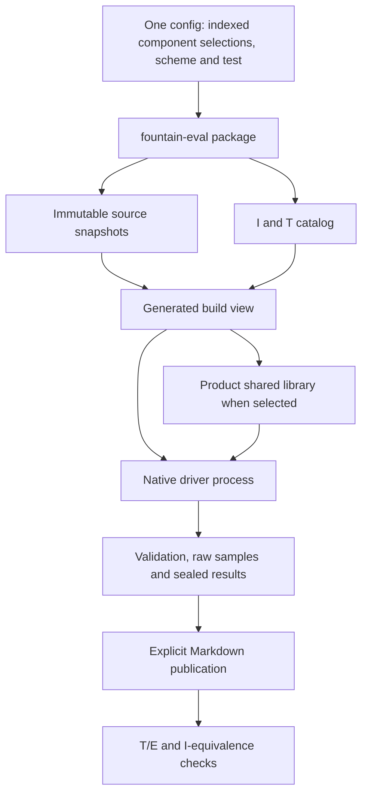

# Fountain evaluation architecture

## From a component change to a comparable result

A developer describes one or more component selections (C), a shared scheme and a complete test content version in one TOML file. Each C contains an engine/operator pair, an engine alone, or an operator alone. Arena is an operator implementation. Scheme selection is explicit; its implementation source defaults to a registered dependency or the selected monorepo and can be overridden for native APIs. Utility and product-facade dependencies remain supporting provenance.

The execution sequence is:

1. Parse the config, resolve its relative paths and load the complete registered test content.
2. Resolve real packages and freeze their source inputs, including dirty local bytes and path dependencies.
3. Select an interface integration, expand every case with explicit applicability reasons, derive common build settings and observe the host environment.
4. Generate an isolated Cargo build view, check version constraints, build, and probe the actual process/library.
5. Validate fixed test inputs independently of the tested operator's arithmetic, then collect the prescribed samples.
6. Seal a unique local result, preserving any failure stage and partial evidence.
7. Publish the selected result with `report` and optionally retain its raw evidence.
8. Compare only complete results with compatible identities and conditions.

`prepare` stops after step 4. `run --prepared` repeats steps 5–6 against that fixed input, observing current runtime conditions. Offline `inspect` only reads declarations; it is not a shortened correctness gate.

## The four-tuple

A completed input identity is `(C,I,T,E)`:

| Dimension | Owns | May change independently |
|---|---|---|
| C: selected components | Selected engine and/or operator identities, scheme, implementation choice, source digests, resolved dependency provenance | Algorithms, layouts, kernels, allocation and internal implementation |
| I: interface integration | Native API conversions, dependency binding, diagnostic build requirements, supported capabilities, driver family | Package/API/trait/product ABI integration |
| T: test content | Input generation, operations, correctness oracle and severity, timing boundary, sampling and metric semantics | Test scenarios, coverage, workload and methodology |
| E: effective experiment configuration | Selected scheme algorithm/mode, T-derived parameters, common compiler/build settings and observed runtime conditions | Host, OS, toolchain, CPU/power/affinity and common build environment |

I and T have independent version-plus-content identities. A published version must not be repointed to changed content. The catalog lock and repository checks detect content that differs from the explicitly recorded candidate. During the current unreleased round the owner has fixed the planned baseline at 0.1.0; published-version rules apply after that first release. Components' declared package versions alone are insufficient: source bytes and dependency locks distinguish two different checkouts carrying the same version string.

Framework package version, serialization schema, run ID, wall-clock time and report renderer are provenance, not additional tuple axes. A semantic change to interface calls or measurement still belongs to I or T even if delivered in a small framework patch.

A failed early stage has no complete tuple. After a successful build/probe, the fixed input tuple can exist even if subsequent correctness fails; that record remains failed and is not eligible for comparison. Raw sample prefixes never imply completion.

## Stable responsibilities and dependencies

The framework is one Cargo package. `src/main.rs` builds the `feval` CLI; library modules own requests, resolution, build views, execution, metrics and evidence. Native Fountain crates are not linked into the framework package. Embedded source templates produce an independent generated driver executable with its own lockfile and release build. The product library has a separate native build and lockfile as well.

Component authors keep their normal repositories and Cargo manifests. They do not copy code into eval, write target manifests, select I, or manually reproduce K/width/repair settings. Changes to registered package identity, workspace layout, features, traits, constructors, operation semantics or product ABI must be communicated to the eval maintainer when the existing mapping cannot compile or preserve the contract.

A stable trait is necessary but not sufficient: its semantics, lifecycle, required support dependencies and available capabilities also matter. The correctness stage detects behavioral conflicts that Cargo cannot see. Version constraints and duplicated trait identities are checked before measurement.

## Configuration and complete test execution

The workspace owns the default config and all run storage. `init` creates and activates a new `feval_workspace` or empties and initializes a supplied existing directory. `activate` persists the canonical workspace path in user state. Each command resolves this path once. Shared directory locks allow concurrent evaluations. `clean` and explicit reset require an exclusive workspace lock.

`src/config.rs` is the user configuration boundary. The CLI reads the active workspace's `fountain-eval.toml` or another workspace file named by `--config`. The config contains component references, scheme selection and the complete content version. Relative component paths use the config directory. Storage paths are derived from the workspace. Unknown fields and user case filters are rejected. The normalized configuration is sealed before execution. Prepared execution uses the stored configuration.

Config is an input to `(C,I,T,E)`, not an additional identity axis. Raw text, comments and filesystem location do not participate in experiment equality. Scheme implementation changes belong to C; the requested scheme algorithm/mode belongs to E. Each operator reference identifies its Rust type in the selected crate. Requested engine/operator Cargo features and default-feature settings belong to C. T owns workload parameters and severity. I owns invocation and diagnostic build requirements. Source forms (path/Git/registry) are independent of invocation forms (Rust API/product ABI).

The content version selects the full catalog, not an individual suite or category. Every case remains in the expanded plan with validation and measurement applicability. Skips have stable reason codes and explanations. Build errors, fatal checks, crashes, interruption and missing expected outputs are failures or unexecuted work; they are not skips. A canonical-plan check prevents an edited skip from concealing a missing result. Native acceptance executes both configured schemes across registered integrations and verifies coverage.

Formal test content has four categories: validation tests (V), operation tests (O), link tests (L) and workflow tests (W). Encoding-plan generation is an engine stage within link testing, not an atomic operation or fifth category. Plan reuse inside complete encoding is workflow testing. The registered formal content implements these four categories; driver and framework acceptance remain separate from component pass/fail results.

The [0.1.0 test plan and report guide](TEST.md) defines the concrete formal cases, their relationships, measurement boundaries and report interpretation. Automatically generated reports record which combinations actually executed and which were blocked by component failures.

## Multiple C selections and single components

The keys `engine0`/`operator0`, `engine1`/`operator1`, and so on group references by a nonnegative integer. Indices may be sparse and execute in numeric order. At least one reference is required per selection. Leading zeros, duplicate keys, unindexed legacy keys and unknown settings are rejected. Scheme and T apply to every C. There is no implicit cross-product or carry-over from another index.

Each C independently traverses resolution, immutable preparation, validation, measurement and reporting. A failure or unsupported selection does not prevent independent later Cs from executing. An interrupt terminates active subprocesses and leaves later Cs `not_executed`. A failed C is never retried automatically. `prepare` applies the same ordering and isolation; `run --prepared` uses only successfully prepared entries and retains the previous statuses/errors for entries it cannot execute.

Engine-only selections execute standalone planning/export capabilities. Their plans are checked after timing with an embedded scalar validation adapter. This is an I-owned validation helper, not a selected production operator; its source is included in I's digest. Codec, replay and operator cases requiring a selected operator remain explicit `component_not_selected` skips. Product APIs that expose no standalone planning capability yield an unsupported result with a complete skip plan.

Operator-only selections execute the pure-operator surface. Their actual engine trait dependency is captured as supporting provenance, not as a tested engine. A captured path dependency or the registered public trait version is used without relaxing constraints; an unmapped trait source is rejected. Codec/plan cases requiring a selected engine remain explicit skips. No production partner is silently selected to expand either single-component scope.

The full original configuration is retained in both the batch and derived per-C inputs. Each C retains its own C/I/T/E, status, coverage and evidence seal. Sharing a batch does not establish comparability: `compare` selects two component results and applies the ordinary compatibility checks.

## Run results, report publication and completion time

Execution returns the batch status and sealed result directory `results/<result-id>/`. The `report` command validates the full evidence and publishes `reports/<result-id>/`. Each report has a plain `report.md` with one section per C and a sibling `index.json.lzma`. Concurrent publication for one run is controlled by its result lease.

The compressed index binds the two files with SHA-256 hashes for the Markdown and the retained snapshot. The snapshot preserves config, resolved plans, identities, build provenance, coverage, fatal witnesses, warning variants, aggregate timings and diagnostic summaries. Individual timing samples and raw logs remain in the sealed result. `report REPORT_DIR` verifies and displays the Markdown and `--json` reads the tracked snapshot. `compare` selects components using `REPORT_DIR#C<N>` and checks retained T/E/I, whole-plan aggregate coverage and fatal witnesses.

Publication stages, syncs and verifies the two files, then atomically renames the directory into place. Later requests for the same sealed run verify and reuse its report. Cleanup rechecks the raw seal and removes the batch, its private cache and any consumed preparation unless `--keep` is supplied. Publication failure preserves the raw result. Successful, failed, unsupported and interrupted runs follow the same lifecycle.

Per-C wall time covers execution phases through the final checkpoint. The batch entry time includes child sealing. The batch total covers the `run` command through evidence collection, with report generation and cleanup performed separately. These times describe progress and are separate from the workload's benchmark clocks.

## Source freezing and build composition

Local Git inputs include tracked and nonignored untracked files, including current modifications and deletions. Non-Git inputs retain their package/workspace layout. Git references fetch exactly the selected full commit, initialize submodules and reject a modified cached checkout. Registry references use an exact version and verify the crate archive against its Cargo lock checksum before extracting it into an owned snapshot.

Path dependencies are captured before computing a build-cache key, including dependencies outside the original repository. Snapshot checks detect concurrent file changes; source hashes include relative paths, bytes and executable bits. Monorepo-relative source includes remain intact. File symlinks within the snapshot are materialized; links escaping the snapshot and directory symlinks are rejected.

Generated build views preserve source files and record original/effective manifests. They expand workspace inheritance and bind selected native dependencies through paths. Cargo receives the requested feature settings in the generated dependency declarations, or as build options on the product library's root crate. Build provenance retains the request and the resolved Cargo metadata for ordinary, diagnostic and product builds. The build view preserves declared upstream version constraints. Unmapped workspace patches/replacements fail explicitly.

Default public engine 2.1 integrations bind scheme and utility 2.1.0 releases. Engine 3 defaults to its monorepo packages. An explicit native scheme source is frozen, bound and checked against actual Cargo metadata. Product integration uses its bundled scheme and rejects external scheme substitution. The current Arena's exact engine 2.1 requirement rejects source engine 3. Successful compilation establishes concrete Rust type identity, and metadata checks reject duplicated/misbound engine identities in the driver graph.

Product integration builds the selected monorepo's real `fountain_bin_ffi` shared library and uses its RQ/R10 facades with SymbolOps callbacks into the selected operator. Binary-side dependencies and callback-side dependencies are separate graphs. Dynamic-loader traces and library hashes establish which shared library was actually loaded. A Linux SONAME alias and platform rpath support normal loading; resources are released through the real facade lifecycles.

Completed cache entries include manifests, source files, lockfiles, driver/library binaries, build logs and a checked metadata index. Reuse verifies these artifacts. Source closure, implementation, I/T identities and common conditions form the cache key. A new external path dependency revision cannot reuse an old build. Dependency resolution is locked per completed build; a fresh cache may resolve different allowed supporting releases, which are recorded in C provenance.

## Interface process boundary

Drivers communicate through a versioned NDJSON protocol on stdout; stderr and build output remain separate logs. The framework checks a hello identity, permitted event types, sample coverage and an explicit completion event. Each invocation uses a bounded child process group. Timeout, interrupt, nonzero exit and protocol errors produce failed/interrupted evidence and terminate remaining child processes.

Terminal progress is an observational host-side view of those same log files. `src/progress.rs` groups execution into preparation, correctness, performance and diagnostics, with aggregate counts and concise outcomes. Observed group transitions identify the current workload. Interactive terminals refresh a status line at most once per second. CI and redirected stderr retain plain milestones with a shared 30-second heartbeat across processes. It verifies the invocation identity before counting events; final protocol and evidence checks remain authoritative. `src/process.rs` tails complete lines with bounded live reads, preserves raw logs and emits a periodic heartbeat without replacing file capture with a driver pipe. This does not change native timers or I/T content. CLI `run`/`prepare` use stderr for progress and stdout for a concise final summary; `--json` selects the structured final response for automation. Library execution is silent unless progress is explicitly enabled.

Validation and measurement are separate process invocations. Validation can wrap operators with participation and destruction counters; measurement uses the raw selected operator. A product API without the full operation surface records those validation or measurement cases as capability skips while executing its supported codec and callback diagnostic cases.

The three integration families share the same T-owned input generation, scalar oracle, workload ordering, clock boundaries and metrics. Their native binding implementations are I-owned. This permits equal T identities across different API families without hiding the effect of a different interface path.

## Validation and measurement ownership

T owns deterministic inputs, the scalar reference, fatal/warning severity, workloads, timers and sampling. I owns calls and observable boundaries. The [test guide](TEST.md) defines concrete cases and methodology; `src/content.rs` and `drivers/workloads.rs` implement that content.

Defined-domain errors are fatal. Registered ambiguous boundaries produce warnings alongside their actual performance. Diagnostic instrumentation is separate from ordinary performance measurement. Exclusive intervals can add up only within the same observed flow; inclusive counters and independent microbenchmarks cannot be summed into another sample's total.

Every successful C requires its complete applicable validation, sample and diagnostic coverage. Failed or interrupted Cs retain their prefixes and unexecuted cases. A valid bounded recovery observation can be incomplete without claiming successful throughput.

## Comparability and attribution

Two results can be compared over their common measured cases when both succeeded, all applicable validation/samples are present, T version and digest match, and E's common conditions match. Registered I implementations must support that T and agree on its timing and fatal-check contract; matching common fatal-check witnesses supply per-run evidence. Canonical applicability is verified before taking the intersection; missing applicable evidence cannot be hidden as a skip. Both coverage tables accompany the comparison, and no common measured cases means rejection. Warning observations are allowed to differ, are included in the comparison and do not participate in its rejection rules. Different I values are therefore not an automatic rejection, and a matching trait name is not equivalence evidence by itself.

E excludes component-specific dependency graphs, native feature mappings, binary hashes and internal implementation choices. Including these as common environment requirements would prevent the component comparisons the framework exists to support. It includes the common build recipe, toolchain/compiler details, relevant Cargo configuration digests, hardware/OS and observable power/affinity conditions. Run IDs, temporary paths, timestamps and uptime observations do not affect equality.

A C-only change is attributed to the selected component combination, including changed supporting dependencies when applicable. An I-only change is attributed to the interface path. When both change, the report states their joint effect. Comparing multiple simultaneous changes does not isolate a single optimization. Equal declared conditions do not eliminate background interference; retain dispersion and worker grouping.

## Evidence lifecycle and ownership

Each invocation creates a unique managed directory. Checkpoints record partial execution and preserve evidence until report publication or explicit cleanup. `config.toml` and `config-resolved.json` retain the supplied and normalized input. `test-plan.json` and `coverage.json` account for every registered case. `correctness.json` distinguishes fatal failures from semantic warnings. Seals detect evidence modification. Preparations retain a verified private cache and can be consumed once. Their output is a normal sealed result.

`clean` empties `results/`, `.fountain-eval/cache/` and `.fountain-eval/prepared/` while retaining the config and `reports/`. Explicit `init DIR` clears the entire target. Implementation acceptance uses a separate workspace and activation state. Maintainers verify its outcomes before removing its temporary data.

Linux/macOS CI checks the framework and publicly accessible native combinations. Private Arena and monorepo combinations are checked on an authorized local host. Platform coverage is explicit; missing CI credentials do not count as private-component coverage. The formal content and applicability rules are specified in the test guide; an unexecuted private or fatal-blocked combination is not positive coverage.

## Implementation map

| Location | Responsibility |
|---|---|
| `src/protocol.rs` | Normalized component/scheme request, reference grammar and offline inspection records |
| `src/config.rs` | Strict TOML input, config-relative paths, defaults and original/resolved input evidence |
| `src/coverage.rs` | Complete per-case validation/measurement/diagnostic coverage and skip reasons |
| `src/runner.rs` | Offline declaration inspection |
| `src/source.rs` | Immutable local/Git/registry snapshots and path dependency closure |
| `src/content.rs` | Pure T-owned expanded case definitions and deterministic matrix |
| `src/workspace.rs` | Workspace initialization and activation, storage ownership, leases and bounded removal |
| `src/artifact.rs` | Report directory and index, verified publication, cleanup and component selection |
| `src/report.rs` | Single Markdown batch/per-C reports and grouped comparison views |
| `src/catalog.rs` | I/T registrations, supported families and embedded assets |
| `src/build.rs` | Workspace expansion, generated manifests, native builds and cache integrity |
| `src/process.rs` | Controlled build environment, subprocess logs, live event observation, timeouts and process-group cleanup |
| `src/progress.rs` | Stage-level progress, shared heartbeat throttling and final CLI summaries |
| `src/batch.rs` | Ordered multi-C execution, checkpoints and child-evidence verification |
| `src/execution.rs` | Stage orchestration, prepared replay, capability and protocol checks |
| `src/validation.rs` | Registered fatal/warning severity, evidence checks and correctness reports |
| `src/measurement.rs` | Raw sample schema, units and deterministic summaries; part of T identity |
| `src/evidence.rs` | Common conditions, result records, seals and comparability |
| `src/util.rs` | Canonical hashing, file formats and common errors |
| `src/main.rs` | CLI parsing, report destinations and exit codes |
| `drivers/common.rs` | Embedded process protocol, worker dispatch and event emission |
| `drivers/workloads.rs` | T-owned correctness, operation, chain and workflow execution |
| `drivers/contracts.rs` | T-owned arithmetic/storage contracts, state histories, dispatch/composition relations and boundary observations; shared by native drivers and fault-injection tests |
| `drivers/reference.rs` | Independent scalar GF/state model and small Gauss-Jordan oracle |
| `drivers/telemetry.rs` | Diagnostic-only allocation accounting with explicit observation scope |
| `drivers/operator.rs` | I-owned operator binding and untimed participation wrapper |
| `drivers/scalar_operator.rs` | I-owned scalar adapter for untimed engine-only plan validation |
| `drivers/native.rs` | Source engine 2/3 constructors, symbol conversion and materialization |
| `drivers/product.rs` | Real product facades and SymbolOps callbacks |
| `scripts/native_acceptance.py` | Maintainer native, failure and reproducibility checks |
| `tests/` | Framework contracts, source capture, evidence, units, processes and CLI tests |

Driver templates are embedded by `include_str!`. A generated driver is an isolated executable build artifact, not another published framework package. Native component code is never checked into this repository.

Deterministic fixtures and scalar references are embedded T content. Framework tests create temporary synthetic sources; the acceptance script creates negative fixtures in its own work directory. These test fixtures are not production components or user performance results. Build views and snapshots live in a per-batch subdirectory of the ignored cache root. C entries within one batch can reuse them; completed batches retain only the Markdown report.
