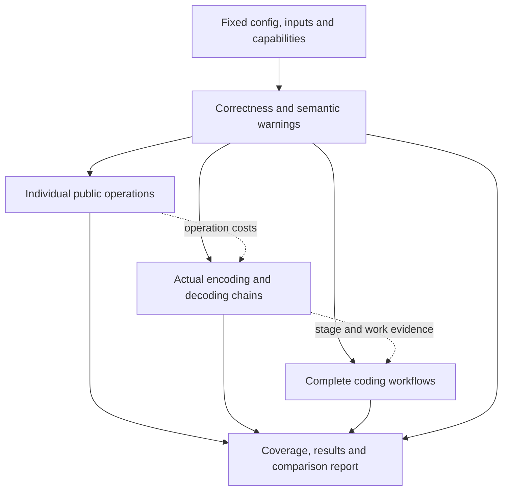

# Fountain evaluation 0.1.0: tests and report interpretation

This guide describes the implemented, unreleased **0.1.0** test content. It explains the fixtures, correctness expectations, measurement boundaries and relationships between results. Configuration, component selection, integration and evidence lifecycle are defined in [DESIGN](DESIGN.md); commands and batch reports are documented in the [README](../README.md).

The full catalog contains 2,182 concrete cases across RQ and R10. Each selected C receives the same catalog with explicit applicability. The configured scheme and available component surfaces determine which cases execute. Engine-only C executes standalone plan construction/export; operator-only C executes the pure-operator surface. Missing components, unavailable capabilities and the R10 K<4 domain are reported as skips. Applicable cases blocked by a fatal failure remain unexecuted.

## Four categories and their relationships

| Category | Question | Main evidence |
| --- | --- | --- |
| Correctness | Does this input produce the required result, and which boundary behaviors differ from the reference? | Fatal checks, non-blocking warnings, expected/actual values and lifecycle observations. |
| Individual operations | How expensive is one public operation under a specified state and working set? | Time per call, calls per second and explicitly defined logical-byte rates. |
| Execution chains | Where is time and work spent along an actual coding path? | Stage durations, operation composition, plan construction/replay and resource diagnostics. |
| Integrated workflows | How fast does the component combination complete a useful coding task? | Output-ready and lifecycle durations, throughput, first-use cost and sustained behavior. |

The categories share deterministic inputs and correctness rules, but measure different boundaries. A scalar reference validates operations. Recorded real operation sequences connect those operations to coding chains. Chain observations explain integrated performance. Integrated performance remains the directly measured outcome rather than a sum of separate microbenchmarks.



Encoding-plan generation belongs to an execution chain because it combines parameter processing, symbolic solving and instruction construction. A plan-generation timing can appear as its own row without becoming an individual-operation category. Reusing that plan across complete blocks belongs to integrated testing. There is no fifth test category for plans.

The labels V01, O01, L01 and W01 below are family references. V stands for validation; C remains reserved for component selections in the CITE tuple. Each expanded case carries its family, category, concrete parameters and requirements; a chain can cover several families through exclusive stages and separately labelled internal observations.

## Fatal and warning expectations


Fatal rules cover wrong output under a defined contract, cross-object data corruption, false completion, invalid resource ownership, crashes on valid inputs, timeouts and malformed or missing required evidence. Warning rules cover explicitly registered ambiguous boundary semantics, including same-ID XOR and repeated-source XOR.

A warning cannot be promoted to fatal merely because two operators disagree. It cannot be downgraded or hidden to make an operator appear clean. Conversely, an end-to-end wrong decoded payload is fatal even if a separate boundary test classified the triggering primitive's ambiguity as warning.

Reference-matching and reference-deviating implementations are both timed. The framework does not equalize their internal work, suppress a fast no-op result, or reject a comparison solely because warning observations differ.

A fatal validation stops successful measurement for the run. Already produced evidence remains, and unfinished cases are marked accordingly. No automatic retry, enlarged repair budget or relaxed timeout turns that attempt into a pass.

## Correctness checks

### V01 — Selected component and scheme participation

Verify source identities, resolved dependency bindings, enabled native features, actual shared-library loading where applicable, scheme parameters and finite-field configuration. An untimed diagnostic operator or callback records participation. The selected implementation must receive the work expected by that scenario; a genuine zero-arithmetic systematic receive path is not required to invent arithmetic calls. It still must demonstrate the expected storage/access path.

Wrong bindings, silent fallback and incorrect requested configuration are fatal. Product binary-side and callback-side provenance remain separate. A callback observation proves callback participation, not that all work inside the product library was delegated to it.

### V02 — Independent arithmetic values

V02 owns the numeric result of the elementary arithmetic calls. It runs **direct calls** for single-source XOR, multiplication by alpha, scalar multiplication and multiply-add. Scalars are 0, 1, 7 and 255. Each call starts from independent initialized storage using zero, 0xff and deterministic pseudorandom bytes at every correctness width. Sources and targets are distinct where the operation has both. The independently implemented GF(256) reference uses polynomial 0x11d, not the tested implementation's tables or kernels.

Compare every expected live symbol byte-for-byte, including untouched sources and neighbors. Any mismatch is fatal. For `dst ^= scalar * src`, scalar zero must preserve the destination. At B=1, direct scalar multiplication additionally exhausts all 256 byte values against all 256 scalars. Successful evidence names the checked operations, data patterns and ordinary/exhaustive check counts.

Zero initialization and storage belong to V03. Multiple-source XOR, broadcast and range operations are established through elementary-call composition in V05. V05 also covers `execute`, so V02 does not repeat the full oracle through both entry points. V06 retains ambiguous alias/overlap cases and its warning policy.

### V03 — Storage, copying, moving and ownership

V03 owns **direct-call storage behavior**: insertion at a new ID, replacement at an existing ID, reading, single-symbol zeroing, single-symbol copy/move, removal and informational association. It uses the same correctness widths and three data patterns as V02. Each operation starts from independent initialized storage; required values and untouched live symbols are checked against the state model.

A copy is followed by an in-place zero write and replacement of its destination, then an in-place zero write and replacement of its source. The zero-write probes use scalar multiplication by 0 and require stored zeros while all other symbols remain unchanged. This checks writing the copied storage, including deferred copy behavior, without repeating V02's GF value matrix. Replacement checks the new stored bytes as well as isolation. After move or removal, insert a new payload under the former source/removed ID and verify that the destination and other live symbols remain correct. Payload, isolation and reuse violations are fatal.

The native trait has no safe membership query. The check does not read a removed/moved ID before reinsertion and does not claim to prove its absence. The informational association has no query API either; only preservation of symbol bytes is observable. Both limits are explicit in successful evidence. Explicit sharing and first-write checks remain in the applicable O08 premeasurement checks. Batch storage and alternate dispatch belong to V05; process/resource destruction belongs to V11.

### V04 — Mixed operation sequences

Run a fixed representative sequence and bounded, fixed-seed generated sequences over a controlled ID space. Include allocation, arithmetic, copy/move, removal and reuse. Compare state after each meaningful prefix to locate the first divergence rather than reporting only the final block checksum.

Sequence generation preserves operation preconditions except in separately registered boundary tests. The report identifies the seed, operation index, operands and first incorrect state. Defined-domain divergence is fatal. This check links individual primitives to the sequences used in real plans.

### V05 — Dispatch and batch composition equivalence

V05 owns relationships between equivalent public calls. It compares observed states directly and does not recompute scalar reference values. Each pair starts from identical independent states at every correctness width and each of the three data patterns.

| Relation | Calls being compared | Fatal condition |
| --- | --- | --- |
| Dispatch | A direct method versus `execute` for every registered operation with an instruction-enum equivalent. | Any expected live symbol differs after the call or the storage follow-up probes. |
| Zero composition | List/range zeroing versus successive direct single-symbol zero calls. | Different live symbol bytes. |
| XOR composition | Two-, three- and general multiple-source XOR versus successive direct single-source XOR calls. | Different live symbol bytes. |
| Broadcast composition | One broadcast versus direct single-source XOR into each destination. | Different live symbol bytes. |
| Copy/move composition | A disjoint range call versus successive direct single-symbol copy/move calls. | Different bytes immediately, after copy-isolation probes, or after source-ID reuse. |

Insertion, lookup and explicit sharing have no instruction-enum counterpart and therefore do not create dispatch pairs. The inputs use distinct XOR operands, unique broadcast destinations and disjoint copy/move ranges. V06 owns ambiguous boundaries. Copy probes modify both sides in place and by replacement; move/removal probes reinsert former IDs on both sides. Observation uses known-live IDs without probing invalid ones.

Successful evidence records the number and kind of comparisons and the observation limits. A direct method may delegate to `execute`; agreement still checks the exposed contract, not whether a fast override exists. Two identically wrong primitive implementations can agree here: V02/V03 provide their independent value/ownership checks. Conversely, a batch defect shared by direct and `execute` is detected by comparison with the elementary sequence.

The dependency is explicit: **V02 establishes arithmetic primitives; V03 establishes storage primitives; V05 establishes their alternate entry points and compositions.** These are different assertions, even when a comparison must execute a primitive again. The previous shared full-oracle loop under all three family names has been removed. Family numbering does not prescribe execution order; any fatal prevents successful measurement for that C.

### V06 — Ambiguous boundary semantics

Observe same-ID XOR, repeated source IDs, a destination occurring among sources, overlapping batch ranges, empty operand lists and self-copy/self-move where the API permits invocation. Each concrete case must state whether the public contract defines its outcome or leaves it ambiguous. The existing same-ID and repeated-source XOR cases remain warning-level.

Record the operation, pre-state, reference expectation, actual post-state, dispatch path and timing observations. For example, same-ID XOR may leave the original bytes instead of producing zeros; both the deviation and its measured cost remain visible. There is no blanket rule that every aliasing problem is only a warning: explicit copy-isolation violations remain fatal under V03.

### V07 — Scheme, source count and padding

Verify requested K, internal padded block size, zero-padding treatment, finite-field selection, source/repair ID mapping and output lengths. Exercise supported small sizes and boundaries around parameter-table transitions. Padding must not appear as additional application payload.

These cases verify systematic source bytes, symbol lengths and the reported padded geometry. They do not provide independent RFC wire-format conformance vectors. V09 supplies an independent arithmetic/linear-algebra check of repairs and recovery.

### V08 — Plan construction, application and reuse

Generate a plan through the component's public symbolic/planning facilities when available. Apply it to independent payloads and compare outputs with the corresponding valid coding result and applicable reference checks. Changing source bytes must not reuse old data. The fixture uses three distinct payloads at fixed geometry; it checks stale-data isolation within the advertised reuse domain. It does not test changing K or width on an existing plan.

Verify reuse with available identity, construction-count or trace evidence rather than inferring it from a faster second call. Distinguish component-owned plan reuse from framework composition of a publicly exported plan. A valid plan may change its instruction ordering across component versions. Wrong payloads, stale mappings and invalid reuse are fatal. A product exposing only combined creation and source replacement can validate those behaviors without claiming to export or separately time its private plan.

### V09 — Encoding and recovery results

Verify systematic symbols, repair generation, recovered payload length and every recovered byte. Check complete source reception and missing-source recovery with deterministic symbol IDs and order. At K=8 and B=31, basis payloads obtain coefficients from the selected encoder. Independent scalar GF(256) arithmetic and Gauss–Jordan elimination then check linear combination and recovery. This checks algebra, not independent RFC conformance.

Recovery success is required for fixtures established as recoverable. Rank-deficient fixtures test the incomplete state; they are not expected to recover. Packet count alone does not prove rank. A performance attempt that does not recover must retain that outcome and cannot report successful recovery throughput. Insufficient input must not be mislabeled as a proven arithmetic defect. False completion or wrong recovered bytes is always fatal.

### V10 — Ordering, duplicates and incremental progress

The fixed K=64 receive fixture checks all-source input, eight omitted sources followed by repairs, repeated source IDs, repair-only input with a 128-symbol bound, and eight repairs before sources. It checks incomplete prefixes and compares recovered bytes. Duplicate repair IDs and calls after completion are not covered by this fixture.

Verify that valid reordering does not corrupt output, duplicates do not create false progress, and the completion status matches materialized data. Different amounts of work or earlier completion across implementations can be valid and must be recorded. Contract violations and incorrect completion are fatal; undefined boundary behavior receives a separately documented warning rule rather than an invented requirement.

### V11 — Errors and resource lifecycle

Exercise documented invalid arguments through safe callable interfaces, callback errors where supported, constructor failure, normal completion and consecutive block processing. Verify error propagation, handle ownership and release on both normal and supported failure paths. Invalid-input tests respect unsafe API preconditions; arbitrary invalid pointers are not part of the standard workload.

Track live component-owned resources or allocator events in diagnostic runs. RSS remaining above its initial value is not, by itself, proof of a leak because allocators may retain reusable memory. Confirmed unreleased ownership, double release, stale state affecting another block, swallowed required errors and crashes on valid input are fatal. Allocator retention and unexplained memory trends are reported as resource observations pending stronger evidence.

## Individual-operation performance

### Common boundary

An individual operation is one public operation semantic, not every internal function or machine instruction. A range operation can process several symbols and still be one public call. Reports therefore include both calls and the operation's width, arity or range length.

Prepare inputs and required storage before timing. For `execute`, prepare the operation object before timing; instruction-list construction and allocation belong to chain tests. Stop the timer before inspecting outputs. Preserve the operation's actual effects and prevent compiler elimination without adding validation to the timed region.

Use independently initialized states where repetition would alter the operation being measured. Repeated XOR on one target, removing an already removed ID or copying an already shared value must not silently replace the intended workload. State restoration is outside the timer and its cache effects must be standardized and recorded.

| Test | Operation and variants | Timed work and interpretation |
| --- | --- | --- |
| O01 | Insert into a new ID; overwrite an existing ID. | The public insertion call, including allocations it performs. Input generation is excluded. Separating new and existing IDs exposes storage-growth costs. |
| O02 | Retrieve a stored symbol reference. | Lookup/reference-return cost. Consuming the reference to preserve execution is controlled; copying the whole symbol is a separate operation. No payload-bandwidth claim follows from a reference lookup. |
| O03 | Zero one symbol, an ID list or a consecutive range. | The selected zero operation, with storage state fixed. Report whether destinations already exist. |
| O04 | One-, two-, three- and general multi-source XOR. | One public call with fixed arity and valid operands. Distinct-ID core rows and warning-level boundary rows are labeled separately. |
| O05 | Broadcast one source into multiple destinations. | One call with a specified destination count. Report calls and destinations processed. |
| O06 | Multiply by alpha, multiply by scalar and multiply-add. | The actual arithmetic call after field setup. Zero/one/general scalar paths remain separate. Field/table initialization is not hidden here. |
| O07 | Single and range copy/move. | The public operation including work required by its storage semantics. Logical bytes are not assumed to be physically copied. |
| O08 | Establish sharing; first write after sharing. | Separate rows expose cheap alias creation and any deferred copy cost. Applicable only where the contract supports sharing. |
| O09 | Remove a live symbol; informational ID association. | Removal or metadata-call cost. These are distinct case rows, not one aggregated benchmark. |

Each applicable O03–O09 operation is exercised through direct and `execute` paths when both exist. Unsupported paths are explicit skips. An interface may return a legitimate unsupported-share result; that does not establish a successful zero-copy implementation.

Working-set variants distinguish repeated access to a small fixed set from cycling through a larger T-defined set. They are described by bytes and access order, not an unverified assertion that data resides in a particular cache level. Internal alignment is a component property; caller-controlled input offsets and non-aligned lengths are recorded when applicable.

O04 and O06 indicate primitive arithmetic cost. O01/O02/O07/O08/O09 explain why a fast arithmetic kernel may still produce a slow operator or codec. No arithmetic-kernel-only result substitutes for the public-operation measurement.

## Execution-chain tests

### Stable stage meanings

Stage names describe work, not a particular engine version's function layout. I maps actual calls and exposed observations to these meanings. Components may fuse, defer or reorder stages while preserving their public contract. The framework follows the actual execution path and does not force a less efficient path merely to obtain more columns.

| Test | Chain segment | Required result and relationship |
| --- | --- | --- |
| L01 | Scheme and context preparation. | Parameter preparation, field setup, operator/storage creation and encoder/decoder context creation, split where observable. Explains costs excluded from preloaded O tests. |
| L02 | Encoding-plan generation. | Time from the required planning inputs to a usable symbolic plan, excluding payload execution. Include solving and instruction construction. Report plan size and operation composition where exposed. |
| L03 | Plan export, retention and binding. | Materialization/export and attachment to the execution context, separate from L02 when the API exposes that boundary. Do not count the same plan allocation twice. |
| L04 | Source loading and padding. | Input import, ID assignment, allocation and zero-padding required for this block. Report actual and padded source counts. |
| L05 | Plan application / intermediate-symbol computation. | Apply the prepared work to payload storage. Include operator calls actually made by this path. Link to its operation histogram and O measurements. |
| L06 | Requested symbol generation. | Source/repair selection, coefficient or degree-set work, instruction generation/dispatch and payload operations for the specified outputs. Report first-output and subsequent-output costs when observable. |
| L07 | Decode input ingestion. | Received-symbol registration, storage and duplicate handling. Some engines perform solving within this call; the parent interval must retain that combined cost. |
| L08 | Decode constraint and solve progression. | Constraint construction, solve attempts and recovered-data computation. Use supported internal observations for finer attribution; solver-specific names are optional diagnostic children. |
| L09 | Output materialization. | Produce the owned application output from internal storage, including actual copying and allocation. A borrowed view is a different boundary and cannot replace this row silently. |
| L10 | Component release. | Destroy coding contexts and their internal operator/callback resources after output handoff. Caller-owned output remains valid for verification outside timing. |
| L11 | Recorded encoding-operation replay. | Generate and capture the real operation sequence outside the replay timer, then execute it against fixed payload state. Isolates the execution portion of encoding. |
| L12 | Recorded decoding-operation replay. | Capture an actual decode scenario's sequence and replay it under its required state. Different loss/order scenarios can yield different programs; retain that provenance. |

L02 constructs a new symbolic plan per observation using the ordinary warmup/sample schedule. W01 separately measures fresh-process complete encoding; there is no dedicated fresh-process plan-only row. A separate cached-plan hit must not masquerade as fast plan generation. A fresh process controls process-local caches, but does not establish cold CPU caches or a cold OS page cache.

Plan generation reports elapsed time and plans/s, plus operation counts and logical plan storage where available. It does not report payload Gbit/s for a symbolic task independent of symbol bytes. Serialized plan size, allocated plan memory and peak construction memory are different metrics.

### How replay supports attribution

An identical replay sequence, initial state, dispatch path and finite field can isolate operator execution differences. Save the sequence digest, operation histogram, IDs, width and state-generation identity. The chosen replay sequence must be derived from actual registered coding work rather than a favorable hand-picked mix.

Different engines may generate different valid sequences. Their replay comparison then includes changed work, not only different operator speed. Report instruction-count and composition changes alongside elapsed time. A drop from 10,000 operations to 7,000 operations must not be described solely as a faster kernel.

When the selected combination cannot export a program, replay is skipped with the capability reason; its normal coding workload still runs. An independently generated surrogate program cannot be silently substituted for that engine's real program.

### Observable and combined stages

Use public call boundaries, existing profiling facilities and optional wrappers in the generated driver. Do not patch upstream algorithm source to force a decomposition. Profiling support can expose implementation-specific children such as sparse reduction, inactive-system work or back-substitution, but the stable report keeps them under the corresponding semantic parent.

Current source interfaces support recorded operation paths. Some development interfaces provide internal profiling. Product creation can combine plan construction, loading and execution behind one API, while source replacement exposes a reuse path. These differences affect observability and I provenance, not the definitions of correctness and useful output.

Every planned stage must be represented by a measured interval, an identified combined parent, or an explicit unavailable diagnostic. Stage unavailability does not imply that the work takes no time. If a supported required observation is missing, treat it as an evidence failure rather than inventing a skip after execution.

## Integrated workflow tests

| Test | Workflow | Setup, timer and output |
| --- | --- | --- |
| W01 | First-use encoding. | In a fresh worker process, measure the first component use through owned output. Process startup is outside the timer and has no separate benchmark row. Library loading is included when it occurs inside the measured constructor; its cost is not separately isolated. No warmup precedes this first-use sample. |
| W02 | Rebuild for every block. | Construct scheme/context/operator as prescribed, import input, compute and materialize the requested output for each block. Process-level tables may already be warm; label this as per-block reconstruction rather than universally cold execution. |
| W03 | Reuse a plan for independent blocks. | Build once, then load distinct payloads and execute the supported reuse path. Report initial construction, first block, later blocks and amortized cost separately. State whether reuse is component-owned or composition of an exported public plan. |
| W04 | Receive all source symbols. | Pre-generate valid inputs outside the timer. Construct a decoder, receive the complete source set and materialize the recovered block. Valid fast paths that avoid solving retain their performance advantage. |
| W05 | Recover missing sources. | Pre-generate a deterministic received sequence. Time decoder construction through recovery and owned output, with the specified missing-source set and ordering. Record symbols consumed and repairs required at completion. |
| W06 | Encode-to-decode round trip. | Directly time encoding, the fixed in-memory omission/order procedure and decoding as one workflow. Report the harness delivery portion. This is not a network transport benchmark. |
| W07 | Consecutive independent blocks. | Process 32 distinct payload blocks using the prescribed reconstruction or supported reuse policy. Record first/later block times, gaps, total batch duration, sustained throughput and state/resource trends. The policy is part of the case. |
| W08 | Complete component lifecycle. | For the relevant W cases, also stop a lifecycle timer after codec/operator/callback release. The owned output has been handed to the caller and is retained for later checking. Distinguish this endpoint from output-ready time. |

Encoding output cases separate source-symbol materialization and repair generation. For repair cases, the selected R determines the work; it must be visible next to the throughput. Decoder input preparation is excluded from W04/W05 so encoder cost cannot leak into decode throughput.

W03 uses actual advertised reuse capabilities. Eval may compose a plan explicitly exported through a supported interface, but it must label that path and include all binding/loading work in its proper scope. It must not reimplement the coding algorithm to manufacture a reuse result. A missing reuse API causes that case to be skipped, while W01/W02 remain applicable.

W07 measures useful-block continuity as well as isolated task latency. A lower output-ready time can coexist with slower release or a larger gap before the next block. Sustained throughput is total completed source bytes divided by the directly measured batch interval, not an average of individual block throughput ratios.

## Workload matrix

Use **B** for symbol bytes so that it cannot be confused with the T identity of test content. Use K for application source symbols, K' for an internal padded source count when applicable, R for generated repair symbols and M for omitted source symbols.

| Dimension | Values or expansion rule |
| --- | --- |
| Main chain and integrated geometry | K = 64, 512, 5008; B = 128, 1016; all six combinations. |
| Individual-operation widths | B = 16, 31, 32, 33, 128, 1016, 4096, 16384. |
| Additional correctness widths | B = 1, 15, 17, 63, 64, 65, 127, 129, 1023, 1024, 1025, plus the operation widths where relevant. |
| Correctness K coverage | K = 1, 4, 9, 10, 11, 63, 64, 65, 511, 512, 513, 5007, 5008, 5009, 5120; B = 31, 128. R10 K=1 is outside its domain. |
| Repair generation | R = 1, 8, ceil(0.1K), deduplicated; source-output materialization is a separate case. |
| Main decode omissions | M = 0, 1, ceil(0.01K), ceil(0.1K), deduplicated. |
| Main reception order | Remaining sources followed by repairs; fixed shuffled mixture of sources and repairs. |
| Additional correctness reception | Contiguous missing ranges, duplicate IDs, repairs first, repair-only recovery and insufficient-information prefixes. |
| Payload patterns | All zero, fixed byte patterns and deterministic pseudorandom bytes. |
| Workload randomness | `0x1971`, `0x2003`, `0x5008`; SplitMix64 payload bytes and deterministic Fisher–Yates order. Preserve each seed separately. |
| Consecutive-block count | 32 different payload blocks per registered continuity case. |
| Repair budget | max(128, 2M + 64), bounded by the registered legal repair-ID domain. Record the effective budget and reason for any applicability restriction. |

This is a layered matrix, not a full Cartesian product of every row. Main coding performance covers the six geometries and prescribed output/recovery cases. Width-tail and state-boundary rules expand only relevant checks. For example, a plan-generation case whose contract is independent of B should not duplicate the same work and present the duplicates as additional evidence.

The executable expansion is in `src/content.rs` and each report's resolved plan in its result index. Operation widths and arities expand independently of codec geometry; plan generation has no payload-width dimension. The catalog retains actual seeds, operands and work counts, including each applicability reason.

Only the configured scheme runs. Both schemes are exercised by maintainer acceptance of the catalog. Scheme-specific reference fixtures may differ, but a baseline/candidate comparison for the same case uses identical inputs. Repair IDs, omission sets, ordering and payload-generation identities belong in evidence.

Stopping at decoder completion is part of the registered recovery workflow, not a changing test budget. Record how much of the fixed offered stream each implementation consumed. A changed amount of work can explain changed time. Budget exhaustion is preserved without automatic extension; no successful decode throughput is emitted for an incomplete block.

## Timing, sampling and resource diagnostics

### Two observation modes

Every applicable workflow gets a minimally instrumented timing run for its main performance result. A separate diagnostic run supplies stage, operation and resource observations. These modes use the same declared input/work definition but have distinct observation settings and provenance. Their samples are not pooled.

Diagnostic wrappers, profiling features and allocation tracking can perturb allocation, dispatch and cache behavior. Measure and disclose the difference from the minimally instrumented run. A negative observed difference is possible due to measurement noise or other execution effects; it is not evidence that instrumentation has negative cost. Neither an assumed zero overhead nor a subtraction-based correction replaces the actual main result.

Input generation, correctness comparisons, logging and report serialization are outside main timers. Work required by the caller-visible operation, such as copying its output into owned storage, remains inside the relevant timer. Avoid logging, filesystem writes and reference-oracle work in measured loops. Perform checked output consumption afterward.

### Additive stage accounting

Use monotonic timestamps within one process and one sample. On a serial path:

```text
flow_time = sum(exclusive_observed_stage_times) + unattributed_time
lifecycle_time = output_ready_time + subsequent_component_release_interval
```

The second equation applies when release follows output handoff in the same measured flow without an intervening validation/reporting interval. Caller-owned input/output lifetime must be stated. Component release excludes freeing the caller's retained result before it can be verified.

An inclusive parent duration contains its children. Display the tree, but add only disjoint intervals at a chosen level. Independently measured medians cannot be summed to reconstruct another sample's total. Independently timed plan build plus independently timed replay is an explanatory model, not a measured full-encode duration.

Unattributed time includes uninstrumented work and the accounting overhead remaining between boundaries; show it explicitly. Substantial unexplained residue is a measurement diagnostic, not automatically a component correctness failure. Negative or overlapping accounting that contradicts the declared timing model is an evidence error. Never clip negative residue to zero to hide incorrect nesting.

If a future component overlaps phases or uses worker threads, report wall-clock intervals, overlap and worker CPU time separately. Their inclusive durations are not additive wall time. Cross-process timestamps are not subtracted without a declared clock relationship.

### Samples and repeat structure

For an ordinary performance case, use three independent worker processes, each with one excluded warmup and five recorded samples: three warmups and 15 samples in total per case/seed. A measured sample may contain a batch of elementary calls. First-use cases instead require fresh-process first observations without warmup; subsequent work is not reused as another first-use sample.

The candidate uses deterministic fixed batches: up to 64 independent instances for the small set and 512 for the large set, capped at 64 MiB of initial symbol bytes. Sixteen symbols are initialized per instance. These sizes are part of T and the actual call count is retained. There is no adaptive retry or hidden change in batch size. Define state preparation consistently and preserve all observed outputs or sufficient checked evidence. A result below usable clock resolution must be reported as unresolved at that resolution rather than an exact zero-time operation.

Keep worker/process grouping, repetition index and workload seed. Three seeds measure different inputs; repeats of one seed measure execution variability for that input. Fifteen samples are not 15 independent machines, nor a basis for precise tail-percentile or production-stability claims.

Retain every recorded sample. Report median, minimum, maximum and dispersion, together with the sample count and process grouping. Do not delete slow observations automatically. Record case order and host observations. When orchestrating a baseline/candidate study, use a prescribed balanced order; comparing already existing files cannot retroactively remove order drift.

### Resource scope

Resource diagnostics report allocation count, cumulative allocated bytes, peak live bytes and retained bytes over the stated lifecycle interval. Process RSS and physical memory/copy traffic are not measured. State which allocator or API surface was observed. Separate build/driver startup and input-fixture allocations from component work where evidence permits.

Shared-library allocations may not pass through a callback-side allocator. An incomplete observation domain must be labeled, not extrapolated to the whole product. Similarly, nominal copy bytes derived from operation calls are not measured memory-bus traffic. Product library allocations are explicitly outside the observed allocator scope. Diagnostic helper allocations remain included; retained caller-owned outputs must be considered when interpreting live bytes.

## Metric definitions and units

Raw elapsed nanoseconds and actual work counts are authoritative. For N completed blocks with identical K and B:

```text
source_payload_Gbit_per_s = N * K * B * 8 / elapsed_ns
repair_output_Gbit_per_s  = actual_repair_output_bytes * 8 / elapsed_ns
operations_per_s         = actual_public_calls * 1e9 / elapsed_ns
ns_per_operation         = elapsed_ns / actual_public_calls
plans_per_s              = completed_plan_builds * 1e9 / elapsed_ns
```

These equations use decimal Gbit/s because nanoseconds supply the factor of 1e9. GB/s and GiB/s are different units and must not share a label. Compute a batch rate from total work and its elapsed time, not an unweighted average of unequal per-item rates.

For example, K=512 and B=1016 represent 520,192 source bytes. Finishing one such block in 1,000,000 ns gives **4.161536 Gbit/s of source-payload-equivalent throughput**. This example is arithmetic, not a measured component result.

Encoding R repair symbols can be normalized to source bytes for application comparison, but also report the actual repair-output rate and R. A small R can produce a high source-equivalent rate without having emitted that many bytes. Decode source-equivalent throughput likewise does not describe network traffic. Report received source/repair counts and bytes separately.

Symbol lookup, move and alias operations primarily report ns/call and calls/s. Logical-byte rates are optional and must say what logical bytes mean. They do not prove that payload bytes were copied. Symbolic plan generation reports time, plans/s and plan/resource sizes, not payload Gbit/s.

Warnings do not change denominators. A boundary call that returns immediately still counts as the nominal call requested by the test, with its actual result visible. Internally executed arithmetic counts are diagnostic data and cannot silently replace the workload's public-call count.

## Expected report contents and reading guide

### Deliverables

The framework automatically produces one Markdown report for the entire configured batch. It embeds every C, groups results by test category, and separates execution wall time from benchmark time. The retained report index preserves validated aggregate results and exact per-case coverage; temporary observations are cleaned after publication. The report is derived from that evidence and is readable locally without uploading component information or results.

The [artifact contracts](../specs/README.md) define `result.json`, configuration, correctness, coverage, raw samples, separate diagnostics and rendered views. The views derive from the same sealed evidence; framework checks verify missing observations, inconsistent work counts and diagnostic accounting.

### Read the report

Start with each component’s outcome and the first failed check or semantic warning group. Read codec throughput at K=512/5008 and widths 128/1016, independent encoding-plan timings, the largest instrumented lifecycle stages and the direct/execute ns per core operation. Coverage distinguishes skipped cases from checks left unfinished. The result index contains timings for the entire matrix, including other widths and seeds, continuity/reuse workloads, allocation metrics and all stage observations. Read it with `feval report REPORT.md --json`.

### How to interpret common patterns

| Observation | Supported interpretation | Additional evidence needed for a stronger claim |
| --- | --- | --- |
| XOR microbenchmarks improve but full encoding does not. | That primitive improved under its tested state; the complete workload did not show the same benefit. | Actual XOR share, instruction mix, setup and output costs. |
| Plan generation slows while plan reuse improves. | First-use and steady-state costs moved in different directions. | Application block count and measured amortized/continuity performance. |
| Replay improves with fewer operations. | Execution became faster for a different program. | Identical-program replay to isolate operator speed. |
| All-source decode is much faster than missing-source recovery. | The two cases can exercise substantially different work, including a legitimate fast path. | Solve activity, symbols consumed and stage evidence. |
| Output-ready latency improves but sustained throughput falls. | Work after output handoff or between blocks offsets the isolated latency gain. | Release intervals, block gaps and allocation/state behavior. |
| A warning-level operation is faster because it returns immediately. | The requested call is faster and has the reported semantic deviation. | Developer judgment about accepting that behavior; the framework does not veto it. |
| Diagnostic timing differs materially from ordinary timing. | Instrumentation or execution conditions affect the observation. | Same-work comparisons and explicit overhead evidence before attributing the diagnostic split. |

An optimization opportunity is a supported location to investigate, not a promised speedup. A measured serial fraction can support a qualified theoretical upper bound, but actual gains depend on interactions, changed work and cache/resource behavior. Avoid automatic causal claims from a single percentage change.


Ordinary workers have a 600-second deadline; fresh-process cases have 60 seconds. Three separate diagnostic workers observe the same ordinary cases. These bounds do not automatically expand after failure. The defined samples characterize these fixed inputs and this host, not production stability.
