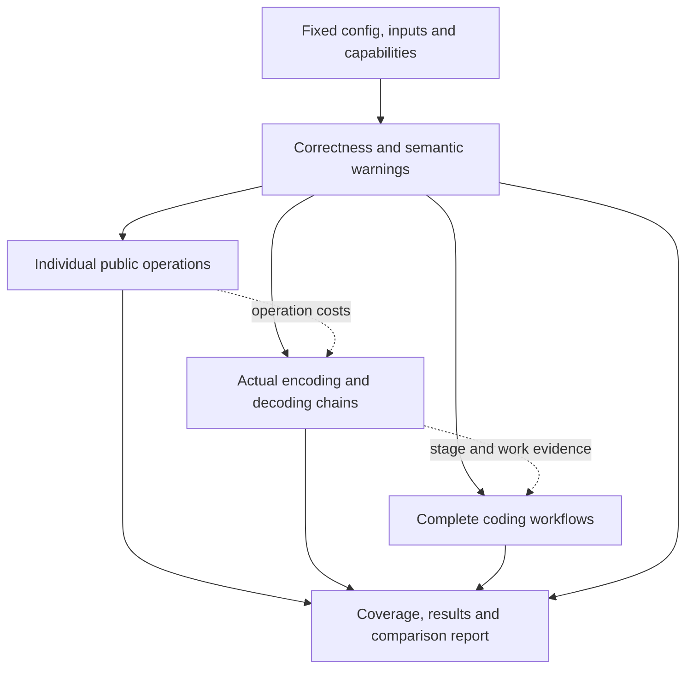

# Fountain evaluation 0.1.0 test plan and report guide

## 1. Document status and reading order

**Status: implemented internal 0.1.0 candidate.** This guide defines the formal test contracts and report interpretation. The [construction record](VALIDATION_FORMAL.md) distinguishes actual passes, component failures and remaining coverage gaps. No release or additional version is introduced.

The old 26-case smoke content has been replaced by the four-category catalog. The CLI now generates ordinary and diagnostic drivers and saves JSON, CSV, Markdown and self-contained HTML views. A registered case does not imply that every component can execute it or that every registered combination has passed.

Read Sections 2–4 to understand the objects and coverage rules; Sections 5–8 define each test family; Sections 9–11 define parameters, timing and metrics; Sections 12–14 explain reports and comparisons. Section 15 states the implementation acceptance boundary. The [architecture](DESIGN.md) owns the C/I/T/E model, and the [artifact contracts](../specs/README.md) describe the currently implemented input and evidence formats.

## 2. What one evaluation measures

A user selects an engine, an operator, a code scheme and a whole test-content version in one configuration file. For example:

```toml
engine = "registry:fountain_engine@2.1.0"
operator = "registry:fountain_operators@2.0.0#slab"
scheme = "rq"
test = "0.1.0"
```

The current command is `fountain-eval run`, optionally with `--config /path/to/experiment.toml`. This command expands and runs the complete applicable formal content. No user-written Cargo manifest or per-case selector is required.

The engine owns coding and solving behavior. The operator owns symbol storage and execution of byte operations. The scheme supplies coding parameters, symbol relationships and precode configuration. Their actual source and dependencies are fixed before execution.

Results retain four independent identities:

| Identity | Meaning for this plan |
| --- | --- |
| C | The actual engine/operator/scheme combination, source digests and component-specific dependency provenance. |
| I | The registered interface binding, capability mapping and conversions used to call that combination. |
| T | The complete test content: cases, reference semantics, input generation, applicability, timing and metric definitions. |
| E | Effective common conditions, including the selected scheme/mode, derived parameters, compiler settings and observed host conditions. |

The candidate targets the currently registered RQ and R10 systematic integrations. A run exercises the configured scheme and accounts for the other scheme's cases as inapplicable. Local, fixed Git and exact registry references are source forms. They do not define separate test methodologies. Native Rust and product ABI calls are interface capabilities selected by I; package names or development-version labels are not test categories.

K, symbol width, loss patterns, seeds, repetitions and output sizes come from T. Users do not choose a category, a case list or a skip list. Optional storage paths remain framework settings. No performance threshold determines correctness.

## 3. Four categories and their relationships

| Category | Question | Main evidence |
| --- | --- | --- |
| Correctness | Does this input produce the required result, and which boundary behaviors differ from the reference? | Fatal checks, non-blocking warnings, expected/actual values and lifecycle observations. |
| Individual operations | How expensive is one public operation under a specified state and working set? | Time per call, calls per second and explicitly defined logical-byte rates. |
| Execution chains | Where is time and work spent along an actual coding path? | Stage durations, operation composition, plan construction/replay and resource diagnostics. |
| Integrated workflows | How fast does the component combination complete a useful coding task? | Output-ready and lifecycle durations, throughput, first-use cost and sustained behavior. |

The categories share deterministic inputs and correctness rules, but measure different boundaries. A scalar reference validates operations. Recorded real operation sequences connect those operations to coding chains. Chain observations explain integrated performance. Integrated performance remains the directly measured outcome rather than a sum of separate microbenchmarks.



Encoding-plan generation belongs to an execution chain because it combines parameter processing, symbolic solving and instruction construction. A plan-generation timing can appear as its own row without becoming an individual-operation category. Reusing that plan across complete blocks belongs to integrated testing. There is no fifth test category for plans.

The labels C01, O01, L01 and W01 below are family references. Each expanded case carries its family, category, concrete parameters and requirements; a chain can cover several families through exclusive stages and separately labelled internal observations.

## 4. Coverage, severity and execution outcomes

### 4.1 Every case is accounted for

Before measurement, the framework expands the whole catalog against the config and verified capabilities. Each case has a separate validation and measurement disposition. A case may validate a callback implementation while lacking a comparable product-side timing surface.

| Disposition | Meaning | Interpretation |
| --- | --- | --- |
| Passed | An executed correctness check met its registered expectation. | A claim about this input and rule, not universal component correctness. |
| Warning | An executed warning-level check differs from its documented reference. | Keep the actual behavior and performance; developers judge the tradeoff. |
| Fatal failure | An executed check violates a required contract or execution/evidence integrity fails. | The run cannot publish a successful performance result. |
| Skipped | Config or a registered capability makes a case inapplicable. | Include the reason and affected scope; never count it as passed. |
| Not executed | A case was applicable but was not reached, for example after a fatal failure or interruption. | Unfinished work, not an applicability skip. |
| Recorded / incomplete measurement | All expected samples exist / only a prefix exists. | A sample prefix is not a completed performance result. |

Examples of legitimate skips include an unselected scheme, a documented unsupported parameter domain, an unavailable public plan-export API, or unavailable internal timing. These reasons must come from registered applicability and verified capabilities. A component claiming a supported interface and then failing compilation or execution is a failure, not a skip. An unknown overall component/interface/scheme request is rejected rather than converted to an empty successful test plan.

A hidden substage remains identified within its observable parent stage. The report must say, for example, "plan construction is included in encoder creation; separate timing unavailable." It must not report zero time or silently omit the stage.

### 4.2 Fatal and warning policy

Fatal rules cover wrong output under a defined contract, cross-object data corruption, false completion, invalid resource ownership, crashes on valid inputs, timeouts and malformed or missing required evidence. Warning rules cover explicitly registered ambiguous boundary semantics, including same-ID XOR and repeated-source XOR.

A warning cannot be promoted to fatal merely because two operators disagree. It cannot be downgraded or hidden to make an operator appear clean. Conversely, an end-to-end wrong decoded payload is fatal even if a separate boundary test classified the triggering primitive's ambiguity as warning.

Reference-matching and reference-deviating implementations are both timed. The framework does not equalize their internal work, suppress a fast no-op result, or reject a comparison solely because warning observations differ.

A fatal validation stops successful measurement for the run. Already produced evidence remains, and unfinished cases are marked accordingly. No automatic retry, enlarged repair budget or relaxed timeout turns that attempt into a pass.

## 5. Correctness checks

### C01 — Selected component and scheme participation

Verify source identities, resolved dependency bindings, enabled native features, actual shared-library loading where applicable, scheme parameters and finite-field configuration. An untimed diagnostic operator or callback records participation. The selected implementation must receive the work expected by that scenario; a genuine zero-arithmetic systematic receive path is not required to invent arithmetic calls. It still must demonstrate the expected storage/access path.

Wrong bindings, silent fallback and incorrect requested configuration are fatal. Product binary-side and callback-side provenance remain separate. A callback observation proves callback participation, not that all work inside the product library was delegated to it.

### C02 — Arithmetic against an independent scalar reference

Check zeroing, single/multiple-source XOR, broadcast XOR, multiplication by alpha, scalar multiplication and multiply-add. Cover scalar zero, scalar one and general nonzero values; small arithmetic fixtures cover the full byte domain. The reference uses independently implemented field arithmetic rather than the tested operator's tables or kernels. The field polynomial must match the selected scheme's declared contract.

Use distinct valid IDs for the core fatal cases. Check affected bytes and untouched symbols, including lengths around vectorization boundaries. A wrong result in this defined domain is fatal. Alias-related cases are handled separately so their warning policy does not weaken ordinary arithmetic checks.

### C03 — Storage, copying, moving and ownership

Check insertion at a new ID, replacement at an existing ID, reading, zero initialization, copying, moving, removal and subsequent ID reuse. A copy must preserve its source and provide the independence promised by the API. A move must preserve destination data and invalidate the source according to the documented contract. Tests must not dereference an invalid source merely to provoke undefined behavior.

When sharing is supported, verify the reported outcome of the share request and the required isolation after either ID is written. An implementation may implement this with copy-on-write or another valid mechanism. Unsupported sharing is distinct from an implementation returning success but corrupting the other symbol. Ownership and payload violations are fatal.

### C04 — Mixed operation sequences

Run a fixed representative sequence and bounded, fixed-seed generated sequences over a controlled ID space. Include allocation, arithmetic, copy/move, removal and reuse. Compare state after each meaningful prefix to locate the first divergence rather than reporting only the final block checksum.

Sequence generation preserves operation preconditions except in separately registered boundary tests. The report identifies the seed, operation index, operands and first incorrect state. Defined-domain divergence is fatal. This check links individual primitives to the sequences used in real plans.

### C05 — Dispatch and batch equivalence

For supported APIs, apply the same semantic operation through direct methods and `execute`. Compare batch copy/move/zero operations with the corresponding valid individual-operation result. Different instructions and different internal implementations are permitted; required final behavior is the oracle.

Record whether a direct method is an override or uses its default dispatch behavior when that can be established. Do not assume that calling a direct method guarantees a fast path. An absent API is an applicability limitation. A defined-domain discrepancy between supported paths is fatal.

### C06 — Ambiguous boundary semantics

Observe same-ID XOR, repeated source IDs, a destination occurring among sources, overlapping batch ranges, empty operand lists and self-copy/self-move where the API permits invocation. Each concrete case must state whether the public contract defines its outcome or leaves it ambiguous. The existing same-ID and repeated-source XOR cases remain warning-level.

Record the operation, pre-state, reference expectation, actual post-state, dispatch path and timing observations. For example, same-ID XOR may leave the original bytes instead of producing zeros; both the deviation and its measured cost remain visible. There is no blanket rule that every aliasing problem is only a warning: explicit copy-isolation violations remain fatal under C03.

### C07 — Scheme, source count and padding

Verify requested K, internal padded block size, zero-padding treatment, finite-field selection, source/repair ID mapping and output lengths. Exercise supported small sizes and boundaries around parameter-table transitions. Padding must not appear as additional application payload.

Where a scheme declares a fixed coding/wire contract, use independently checked vectors for source symbols and selected repair IDs. Do not freeze one implementation's internal operation sequence as the coding standard. Cross-implementation encoded-byte equality is required only when their declared coding contracts match. Violations of the declared scheme contract are fatal.

### C08 — Plan construction, application and reuse

Generate a plan through the component's public symbolic/planning facilities when available. Apply it to independent payloads and compare outputs with the corresponding valid coding result and applicable reference checks. Changing source bytes must not reuse old data. Change K, scheme/field settings, width or repair range only according to the plan API's declared reuse domain; check required invalidation or rejection outside that domain.

Verify reuse with available identity, construction-count or trace evidence rather than inferring it from a faster second call. Distinguish component-owned plan reuse from framework composition of a publicly exported plan. A valid plan may change its instruction ordering across component versions. Wrong payloads, stale mappings and invalid reuse are fatal. A product exposing only combined creation and source replacement can validate those behaviors without claiming to export or separately time its private plan.

### C09 — Encoding and recovery results

Verify systematic symbols, repair generation, recovered payload length and every recovered byte. Check complete source reception and missing-source recovery with deterministic symbol IDs and order. An implementation's own encode/decode round trip is useful but insufficient: combine it with C02/C07 and small-system independent linear-algebra checks.

Recovery success is required for fixtures established as recoverable. Rank-deficient fixtures test the incomplete state; they are not expected to recover. Packet count alone does not prove rank. A performance attempt that does not recover must retain that outcome and cannot report successful recovery throughput. Insufficient input must not be mislabeled as a proven arithmetic defect. False completion or wrong recovered bytes is always fatal.

### C10 — Ordering, duplicates and incremental progress

Feed sources first, mixed source/repair order, repairs before sources and incremental batches. Check repeated source and repair IDs according to the registered API contract. Include incomplete prefixes and completion followed by further permitted API calls.

Verify that valid reordering does not corrupt output, duplicates do not create false progress, and the completion status matches materialized data. Different amounts of work or earlier completion across implementations can be valid and must be recorded. Contract violations and incorrect completion are fatal; undefined boundary behavior receives a separately documented warning rule rather than an invented requirement.

### C11 — Errors and resource lifecycle

Exercise documented invalid arguments through safe callable interfaces, callback errors where supported, constructor failure, normal completion and consecutive block processing. Verify error propagation, handle ownership and release on both normal and supported failure paths. Invalid-input tests respect unsafe API preconditions; arbitrary invalid pointers are not part of the standard workload.

Track live component-owned resources or allocator events in diagnostic runs. RSS remaining above its initial value is not, by itself, proof of a leak because allocators may retain reusable memory. Confirmed unreleased ownership, double release, stale state affecting another block, swallowed required errors and crashes on valid input are fatal. Allocator retention and unexplained memory trends are reported as resource observations pending stronger evidence.

## 6. Individual-operation performance

### 6.1 Common boundary

An individual operation is one public operation semantic, not every internal function or machine instruction. A range operation can process several symbols and still be one public call. Reports therefore include both calls and the operation's width, arity or range length.

Prepare inputs and required storage before timing. For `execute`, prepare the operation object before timing; instruction-list construction and allocation belong to chain tests. Stop the timer before inspecting outputs. Preserve the operation's actual effects and prevent compiler elimination without adding validation to the timed region.

Use independently initialized states where repetition would alter the operation being measured. Repeated XOR on one target, removing an already removed ID or copying an already shared value must not silently replace the intended workload. State restoration is outside the timer and its cache effects must be standardized and recorded.

| Test | Operation and variants | Timed work and interpretation |
| --- | --- | --- |
| O01 | Insert into a new ID; overwrite an existing ID. | The public insertion call, including allocations it performs. Input generation is excluded. Separating new and existing IDs exposes storage-growth costs. |
| O02 | Retrieve a stored symbol reference. | Lookup/reference-return cost. Consuming the reference to preserve execution is controlled; copying the whole symbol is a separate operation. No payload-bandwidth claim follows from a reference lookup. |
| O03 | Zero one symbol, an ID list or a consecutive range. | The selected zero operation, with storage state fixed. Report whether destinations already exist. |
| O04 | One-, two-, three- and general multi-source XOR. | One public call with fixed arity and valid operands. Distinct-ID core rows and warning-level boundary rows are labeled separately. |
| O05 | Broadcast one source into multiple destinations. | One call with a specified destination count. Report calls and destinations processed. |
| O06 | Multiply by alpha, multiply by scalar and multiply-add. | The actual arithmetic call after field setup. Zero/one/general scalar paths remain separate. Field/table initialization is not hidden here. |
| O07 | Single and range copy/move. | The public operation including work required by its storage semantics. Logical bytes are not assumed to be physically copied. |
| O08 | Establish sharing; first write after sharing. | Separate rows expose cheap alias creation and any deferred copy cost. Applicable only where the contract supports sharing. |
| O09 | Remove a live symbol; informational ID association. | Removal or metadata-call cost. These are distinct case rows, not one aggregated benchmark. |

Each applicable O03–O09 operation is exercised through direct and `execute` paths when both exist. Unsupported paths are explicit skips. An interface may return a legitimate unsupported-share result; that does not establish a successful zero-copy implementation.

Working-set variants distinguish repeated access to a small fixed set from cycling through a larger T-defined set. They are described by bytes and access order, not an unverified assertion that data resides in a particular cache level. Internal alignment is a component property; caller-controlled input offsets and non-aligned lengths are recorded when applicable.

O04 and O06 indicate primitive arithmetic cost. O01/O02/O07/O08/O09 explain why a fast arithmetic kernel may still produce a slow operator or codec. No arithmetic-kernel-only result substitutes for the public-operation measurement.

## 7. Execution-chain tests

### 7.1 Stable stage meanings

Stage names describe work, not a particular engine version's function layout. I maps actual calls and exposed observations to these meanings. Components may fuse, defer or reorder stages while preserving their public contract. The framework follows the actual execution path and does not force a less efficient path merely to obtain more columns.

| Test | Chain segment | Required result and relationship |
| --- | --- | --- |
| L01 | Scheme and context preparation. | Parameter preparation, field setup, operator/storage creation and encoder/decoder context creation, split where observable. Explains costs excluded from preloaded O tests. |
| L02 | Encoding-plan generation. | Time from the required planning inputs to a usable symbolic plan, excluding payload execution. Include solving and instruction construction. Report plan size and operation composition where exposed. |
| L03 | Plan export, retention and binding. | Materialization/export and attachment to the execution context, separate from L02 when the API exposes that boundary. Do not count the same plan allocation twice. |
| L04 | Source loading and padding. | Input import, ID assignment, allocation and zero-padding required for this block. Report actual and padded source counts. |
| L05 | Plan application / intermediate-symbol computation. | Apply the prepared work to payload storage. Include operator calls actually made by this path. Link to its operation histogram and O measurements. |
| L06 | Requested symbol generation. | Source/repair selection, coefficient or degree-set work, instruction generation/dispatch and payload operations for the specified outputs. Report first-output and subsequent-output costs when observable. |
| L07 | Decode input ingestion. | Received-symbol registration, storage and duplicate handling. Some engines perform solving within this call; the parent interval must retain that combined cost. |
| L08 | Decode constraint and solve progression. | Constraint construction, solve attempts and recovered-data computation. Use supported internal observations for finer attribution; solver-specific names are optional diagnostic children. |
| L09 | Output materialization. | Produce the owned application output from internal storage, including actual copying and allocation. A borrowed view is a different boundary and cannot replace this row silently. |
| L10 | Component release. | Destroy coding contexts and their internal operator/callback resources after output handoff. Caller-owned output remains valid for verification outside timing. |
| L11 | Recorded encoding-operation replay. | Generate and capture the real operation sequence outside the replay timer, then execute it against fixed payload state. Isolates the execution portion of encoding. |
| L12 | Recorded decoding-operation replay. | Capture an actual decode scenario's sequence and replay it under its required state. Different loss/order scenarios can yield different programs; retain that provenance. |

L02 includes first-use and repeated-construction observations without an intentionally reused plan. A separate cached-plan hit must not masquerade as fast plan generation. A fresh process controls process-local caches, but does not establish cold CPU caches or a cold OS page cache.

Plan generation reports elapsed time and plans/s, plus operation counts and logical plan storage where available. It does not report payload Gbit/s for a symbolic task independent of symbol bytes. Serialized plan size, allocated plan memory and peak construction memory are different metrics.

### 7.2 How replay supports attribution

An identical replay sequence, initial state, dispatch path and finite field can isolate operator execution differences. Save the sequence digest, operation histogram, IDs, width and state-generation identity. The chosen replay sequence must be derived from actual registered coding work rather than a favorable hand-picked mix.

Different engines may generate different valid sequences. Their replay comparison then includes changed work, not only different operator speed. Report instruction-count and composition changes alongside elapsed time. A drop from 10,000 operations to 7,000 operations must not be described solely as a faster kernel.

When the selected combination cannot export a program, replay is skipped with the capability reason; its normal coding workload still runs. An independently generated surrogate program cannot be silently substituted for that engine's real program.

### 7.3 Observable and combined stages

Use public call boundaries, existing profiling facilities and optional wrappers in the generated driver. Do not patch upstream algorithm source to force a decomposition. Profiling support can expose implementation-specific children such as sparse reduction, inactive-system work or back-substitution, but the stable report keeps them under the corresponding semantic parent.

Current source interfaces support recorded operation paths. Some development interfaces provide internal profiling. Product creation can combine plan construction, loading and execution behind one API, while source replacement exposes a reuse path. These differences affect observability and I provenance, not the definitions of correctness and useful output.

Every planned stage must be represented by a measured interval, an identified combined parent, or an explicit unavailable diagnostic. Stage unavailability does not imply that the work takes no time. If a supported required observation is missing, treat it as an evidence failure rather than inventing a skip after execution.

## 8. Integrated workflow tests

| Test | Workflow | Setup, timer and output |
| --- | --- | --- |
| W01 | First-use encoding. | In a fresh worker process, measure the first component use through owned output. Record process startup and product-library loading separately; the main codec timer starts at the documented component-entry boundary. No warmup precedes this first-use sample. |
| W02 | Rebuild for every block. | Construct scheme/context/operator as prescribed, import input, compute and materialize the requested output for each block. Process-level tables may already be warm; label this as per-block reconstruction rather than universally cold execution. |
| W03 | Reuse a plan for independent blocks. | Build once, then load distinct payloads and execute the supported reuse path. Report initial construction, first block, later blocks and amortized cost separately. State whether reuse is component-owned or composition of an exported public plan. |
| W04 | Receive all source symbols. | Pre-generate valid inputs outside the timer. Construct a decoder, receive the complete source set and materialize the recovered block. Valid fast paths that avoid solving retain their performance advantage. |
| W05 | Recover missing sources. | Pre-generate a deterministic received sequence. Time decoder construction through recovery and owned output, with the specified missing-source set and ordering. Record symbols consumed and repairs required at completion. |
| W06 | Encode-to-decode round trip. | Directly time encoding, the fixed in-memory omission/order procedure and decoding as one workflow. Report the harness delivery portion. This is not a network transport benchmark. |
| W07 | Consecutive independent blocks. | Process 32 distinct payload blocks using the prescribed reconstruction or supported reuse policy. Record first/later block times, gaps, total batch duration, sustained throughput and state/resource trends. The policy is part of the case. |
| W08 | Complete component lifecycle. | For the relevant W cases, also stop a lifecycle timer after codec/operator/callback release. The owned output has been handed to the caller and is retained for later checking. Distinguish this endpoint from output-ready time. |

Encoding output cases separate source-symbol materialization and repair generation. For repair cases, the selected R determines the work; it must be visible next to the throughput. Decoder input preparation is excluded from W04/W05 so encoder cost cannot leak into decode throughput.

W03 uses actual advertised reuse capabilities. Eval may compose a plan explicitly exported through a supported interface, but it must label that path and include all binding/loading work in its proper scope. It must not reimplement the coding algorithm to manufacture a reuse result. A missing reuse API causes that case to be skipped, while W01/W02 remain applicable.

W07 measures useful-block continuity as well as isolated task latency. A lower output-ready time can coexist with slower release or a larger gap before the next block. Sustained throughput is total completed source bytes divided by the directly measured batch interval, not an average of individual block throughput ratios.

## 9. Proposed workload matrix

Use **B** for symbol bytes so that it cannot be confused with the T identity of test content. Use K for application source symbols, K' for an internal padded source count when applicable, R for generated repair symbols and M for omitted source symbols.

| Dimension | Candidate values or expansion rule |
| --- | --- |
| Main chain and integrated geometry | K = 64, 512, 5008; B = 128, 1016; all six combinations. |
| Individual-operation widths | B = 16, 31, 32, 33, 128, 1016, 4096, 16384. |
| Additional correctness widths | B = 1, 15, 17, 63, 64, 65, 127, 129, 1023, 1024, 1025, plus the operation widths where relevant. |
| Correctness K coverage | Supported small sizes, both padded/unpadded sizes and registered parameter-transition neighbors; include 511/512/513 and 5007/5008/5009 where valid. |
| Repair generation | R = 1, 8, ceil(0.1K), deduplicated; source-output materialization is a separate case. |
| Main decode omissions | M = 0, 1, ceil(0.01K), ceil(0.1K), deduplicated. |
| Main reception order | Remaining sources followed by repairs; fixed shuffled mixture of sources and repairs. |
| Additional correctness reception | Contiguous missing ranges, duplicate IDs, repairs first, repair-only recovery and insufficient-information prefixes. |
| Payload patterns | All zero, fixed byte patterns and deterministic pseudorandom bytes. |
| Workload randomness | Three T-owned fixed seeds for random payload/loss/order cases; preserve each seed separately. |
| Consecutive-block count | 32 different payload blocks per registered continuity case. |
| Repair budget | max(128, 2M + 64), bounded by the registered legal repair-ID domain. Record the effective budget and reason for any applicability restriction. |

This is a layered matrix, not a full Cartesian product of every row. Main coding performance covers the six geometries and prescribed output/recovery cases. Width-tail and state-boundary rules expand only relevant checks. For example, a plan-generation case whose contract is independent of B should not duplicate the same work and present the duplicates as additional evidence.

The final implementation must put the exact seeds, generator algorithm, small-K list, parameter-transition list, arity/range values and working-set sizes into the T-owned catalog before acceptance. These are review-draft details still to be frozen, not settings to request from users or silently infer from a candidate's preferred values. Their exact expansion and total case/sample count must be inspectable before a run. A component's erroneous parameter report cannot redefine the valid domain to hide a failure.

Only the configured scheme runs. Both schemes are exercised by maintainer acceptance of the catalog. Scheme-specific reference fixtures may differ, but a baseline/candidate comparison for the same case uses identical inputs. Repair IDs, omission sets, ordering and payload-generation identities belong in evidence.

Stopping at decoder completion is part of the registered recovery workflow, not a changing test budget. Record how much of the fixed offered stream each implementation consumed. A changed amount of work can explain changed time. Budget exhaustion is preserved without automatic extension; no successful decode throughput is emitted for an incomplete block.

## 10. Timing, sampling and resource diagnostics

### 10.1 Two observation modes

Every applicable workflow gets a minimally instrumented timing run for its main performance result. A separate diagnostic run supplies stage, operation and resource observations. These modes use the same declared input/work definition but have distinct observation settings and provenance. Their samples are not pooled.

Diagnostic wrappers, profiling features and allocation tracking can perturb allocation, dispatch and cache behavior. Measure and disclose the difference from the minimally instrumented run. A negative observed difference is possible due to measurement noise or other execution effects; it is not evidence that instrumentation has negative cost. Neither an assumed zero overhead nor a subtraction-based correction replaces the actual main result.

Input generation, correctness comparisons, logging and report serialization are outside main timers. Work required by the caller-visible operation, such as copying its output into owned storage, remains inside the relevant timer. Avoid logging, filesystem writes and reference-oracle work in measured loops. Perform checked output consumption afterward.

### 10.2 Additive stage accounting

Use monotonic timestamps within one process and one sample. On a serial path:

```text
flow_time = sum(exclusive_observed_stage_times) + unattributed_time
lifecycle_time = output_ready_time + subsequent_component_release_interval
```

The second equation applies when release follows output handoff in the same measured flow without an intervening validation/reporting interval. Caller-owned input/output lifetime must be stated. Component release excludes freeing the caller's retained result before it can be verified.

An inclusive parent duration contains its children. Display the tree, but add only disjoint intervals at a chosen level. Independently measured medians cannot be summed to reconstruct another sample's total. Independently timed plan build plus independently timed replay is an explanatory model, not a measured full-encode duration.

Unattributed time includes uninstrumented work and the accounting overhead remaining between boundaries; show it explicitly. Substantial unexplained residue is a measurement diagnostic, not automatically a component correctness failure. Negative or overlapping accounting that contradicts the declared timing model is an evidence error. Never clip negative residue to zero to hide incorrect nesting.

If a future component overlaps phases or uses worker threads, report wall-clock intervals, overlap and worker CPU time separately. Their inclusive durations are not additive wall time. Cross-process timestamps are not subtracted without a declared clock relationship.

### 10.3 Samples and repeat structure

For an ordinary performance case, use three independent worker processes, each with one excluded warmup and five recorded samples: three warmups and 15 samples in total per case/seed. A measured sample may contain a batch of elementary calls. First-use cases instead require fresh-process first observations without warmup; subsequent work is not reused as another first-use sample.

The candidate uses deterministic fixed batches: up to 64 independent instances for the small set and 512 for the large set, capped at 64 MiB of initial symbol bytes. Sixteen symbols are initialized per instance. These sizes are part of T and the actual call count is retained. There is no adaptive retry or hidden change in batch size. Define state preparation consistently and preserve all observed outputs or sufficient checked evidence. A result below usable clock resolution must be reported as unresolved at that resolution rather than an exact zero-time operation.

Keep worker/process grouping, repetition index and workload seed. Three seeds measure different inputs; repeats of one seed measure execution variability for that input. Fifteen samples are not 15 independent machines, nor a basis for precise tail-percentile or production-stability claims.

Retain every recorded sample. Report median, minimum, maximum and dispersion, together with the sample count and process grouping. Do not delete slow observations automatically. Record case order and host observations. When orchestrating a baseline/candidate study, use a prescribed balanced order; comparing already existing files cannot retroactively remove order drift.

### 10.4 Resource scope

Resource diagnostics should report allocation count, cumulative allocated bytes, peak live allocated bytes, retained bytes after component release, nominal payload-copy work and available process-memory observations. State which allocator or API surface was observed. Separate build/driver startup and input-fixture allocations from component work where evidence permits.

Shared-library allocations may not pass through a callback-side allocator. An incomplete observation domain must be labeled, not extrapolated to the whole product. Similarly, nominal copy bytes derived from operation calls are not measured memory-bus traffic. Unsupported resource instrumentation is an explicit diagnostic skip while ordinary timing remains available.

## 11. Metric definitions and units

Raw elapsed nanoseconds and actual work counts are authoritative. For N completed blocks with identical K and B:

```text
source_payload_Gbit_per_s = N * K * B * 8 / elapsed_ns
repair_output_Gbit_per_s  = actual_repair_output_bytes * 8 / elapsed_ns
operations_per_s         = actual_public_calls * 1e9 / elapsed_ns
ns_per_operation         = elapsed_ns / actual_public_calls
plans_per_s              = completed_plan_builds * 1e9 / elapsed_ns
```

These equations use decimal Gbit/s because nanoseconds supply the factor of 1e9. GB/s and GiB/s are different units and must not share a label. Compute a batch rate from total work and its elapsed time, not an unweighted average of unequal per-item rates.

For example, K=512 and B=1016 represent 520,192 source bytes. Finishing one such block in 1,000,000 ns gives **4.161536 Gbit/s of source-payload-equivalent throughput**. This example is arithmetic, not a measured component result.

Encoding R repair symbols can be normalized to source bytes for application comparison, but also report the actual repair-output rate and R. A small R can produce a high source-equivalent rate without having emitted that many bytes. Decode source-equivalent throughput likewise does not describe network traffic. Report received source/repair counts and bytes separately.

Symbol lookup, move and alias operations primarily report ns/call and calls/s. Logical-byte rates are optional and must say what logical bytes mean. They do not prove that payload bytes were copied. Symbolic plan generation reports time, plans/s and plan/resource sizes, not payload Gbit/s.

Warnings do not change denominators. A boundary call that returns immediately still counts as the nominal call requested by the test, with its actual result visible. Internally executed arithmetic counts are diagnostic data and cannot silently replace the workload's public-call count.

## 12. Expected report contents and reading guide

### 12.1 Deliverables

The formal implementation produces a self-contained HTML report, a concise human-readable summary, structured JSON/CSV and the sealed raw evidence needed to reproduce calculations. HTML is a view of the evidence, not a separate source of truth. It must work locally without uploading component information or results.

The [artifact contracts](../specs/README.md) define `result.json`, configuration, correctness, coverage, raw samples, separate diagnostics and rendered views. The views derive from the same sealed evidence; framework checks verify missing observations, inconsistent work counts and diagnostic accounting.

### 12.2 Read reports in this order

| Report panel | What to examine | What it prevents |
| --- | --- | --- |
| Run identity and scope | C/I/T/E, selected scheme, host, build mode, observation mode and run status. | Comparing different experiments as if only an operator changed. |
| Coverage | Every case's applicability, validation and measurement status; exact skip reasons and combined stages. | Treating skipped/unexecuted work as passed or zero-cost. |
| Correctness | Fatal checks, warning observations, first divergence and resource/lifecycle outcomes. | Hiding ambiguous semantics behind a clean throughput number. |
| Integrated results | Encode/decode/reuse/continuity rows, geometry, R/M, work consumed, endpoint and dispersion. | Confusing kernel speed with useful application performance. |
| Chain decomposition | Stage tree, exclusive/inclusive labels, unattributed time and diagnostics overhead. | Double counting nested stages or inventing a complete decomposition. |
| Operation results | Per-operation state, width, arity, dispatch, calls and warning status. | Comparing different primitive workloads under one name. |
| Work and resource composition | Operation histogram, plan size, allocation/copy observations and their domains. | Attributing reduced work entirely to faster execution. |
| Baseline comparison | Matched cases, missing coverage, absolute/relative changes and variability. | Claiming a global winner from an incomplete intersection. |
| Explanation and limitations | Supported findings, plausible causes and unavailable evidence, visibly distinguished. | Presenting a performance hypothesis as a verified root cause. |

A summary such as "succeeded with warnings and skips" must link to the affected cases. Present expected/actual values at a useful level, with full byte evidence or an exact first-difference location available for inspection. Do not bury warning details only in an appendix while placing an unqualified ranking at the top.

Useful charts include latency/throughput against K and B, distributions of individual samples, per-block timelines and stacked exclusive stage bars. A stage bar must show unobserved/combined scope rather than implying a complete measured breakdown. Zero-valued bars and unavailable measurements must be visually distinct.

### 12.3 How to interpret common patterns

| Observation | Supported interpretation | Additional evidence needed for a stronger claim |
| --- | --- | --- |
| XOR microbenchmarks improve but full encoding does not. | That primitive improved under its tested state; the complete workload did not show the same benefit. | Actual XOR share, instruction mix, setup and output costs. |
| Plan generation slows while plan reuse improves. | First-use and steady-state costs moved in different directions. | Application block count and measured amortized/continuity performance. |
| Replay improves with fewer operations. | Execution became faster for a different program. | Identical-program replay to isolate operator speed. |
| All-source decode is much faster than missing-source recovery. | The two cases can exercise substantially different work, including a legitimate fast path. | Solve activity, symbols consumed and stage evidence. |
| Output-ready latency improves but sustained throughput falls. | Work after output handoff or between blocks offsets the isolated latency gain. | Release intervals, block gaps and allocation/state behavior. |
| A warning-level operation is faster because it returns immediately. | The requested call is faster and has the reported semantic deviation. | Developer judgment about accepting that behavior; the framework does not veto it. |
| Diagnostic timing differs materially from ordinary timing. | Instrumentation or execution conditions affect the observation. | Same-work comparisons and explicit overhead evidence before attributing the diagnostic split. |

An optimization opportunity is a supported location to investigate, not a promised speedup. A measured serial fraction can support a qualified theoretical upper bound, but actual gains depend on interactions, changed work and cache/resource behavior. Avoid automatic causal claims from a single percentage change.

## 13. Comparing component versions

Start with evidence validity and complete applicable coverage. A normal comparison requires matching T content and common E conditions, plus the registered I equivalence for the measured case. Compare like-for-like scopes: first-use with first-use, output-ready with output-ready, reused-plan work with the same reuse policy, and ordinary timing with ordinary timing.

Take the intersection of genuinely measured comparable cases only after verifying that each run completed its own applicable plan. Show both coverage tables and excluded rows. Product/native comparison may legitimately contain codec rows while lacking a common pure-operator row. No row is synthesized for the absent measurement.

C may change; I may change if equivalence for the same T scope is established. A C-only change is attributed to the component combination, including its supporting dependency changes. A C-and-I change is explicitly joint. Warning differences stay visible and do not block comparison. Different requested scheme algorithms/modes remain different E conditions; cross-scheme studies require their own declared methodology.

For baseline latency b and candidate latency c under identical work:

```text
absolute_latency_change = c - b
latency_change_percent  = (c / b - 1) * 100
speedup                = b / c
```

If a baseline takes 8 ms and a candidate takes 6 ms, latency decreases by 25% and speedup is 1.333x. Under equal work, throughput increases by 33.3%, not 25%. These are illustrative values. Report the actual sample distributions beside ratios; a small median shift alone does not establish a stable improvement.

For stage attribution, compare stage times from equivalent observations and show absolute time changes. Do not sum percentage changes. The sum of independent stage medians need not equal either integrated median. If input consumption or operation counts differ, report those differences before attributing the total change to execution speed.

## 14. Failures, skips and reproducibility evidence

Each report must retain the config text and resolved input, immutable component/source identities, dependency and build provenance, effective parameters, expanded coverage plan, reference expectations, warning observations, raw samples, process outcomes and diagnostic scope. Preserve run/worker/seed relationships and the original failed or interrupted prefix.

Reproduction uses fixed input snapshots or equivalent verified inputs. Changing the original workspace after preparation must not alter prepared execution. A fresh process does not erase source identity, build identity or declared cache/reuse policy. A later successful run is a separate attempt and must not overwrite the failed result.

Examples of report language:

- "Skipped: the selected product ABI does not expose an encoding-plan export operation; plan work remains included in encoder creation."
- "Warning: self-XOR preserved the source bytes rather than producing the scalar reference's zero bytes; timing is retained."
- "Not executed: validation stopped after a fatal copy-isolation failure."
- "Incomplete recovery: the fixed repair budget was exhausted; no successful recovery throughput is reported."
- "Unavailable diagnostic: callback allocation tracking does not observe allocations inside the shared library."

Timeouts, crashes, malformed outputs and missing applicable samples are never phrased as ordinary capability skips. Correctness findings and measurement-quality diagnostics remain distinguishable: neither a noisy sample nor a slow implementation is an arithmetic failure.

## 15. Implementation acceptance for this plan

Delivery requires all four categories, their shared correctness rules, the expanded matrix, report rendering and comparison semantics to work together. Intermediate implementation of a few microbenchmarks does not complete the plan.

Acceptance must demonstrate:

1. Every registered case has a defined contract, applicability rule, timing/work definition and report location; every applicable observation is required.
2. The exact matrix, seeds, batch policy and resource scope are frozen in the T candidate before final validation. No user case-selection knobs are added.
3. Public native 2.1 and compatible development/product integrations execute their supported cases. Current source-engine/Arena conflicts remain explicit failures before measurement.
4. Both schemes and all registered operations are exercised across supported combinations. A catalog reachability check detects an entry that no supported acceptance configuration executes. Universally unavailable placeholders must be resolved, deferred explicitly in the review draft or removed before release; ordinary per-config skips remain visible.
5. Independent references catch injected wrong arithmetic/output, while boundary warnings remain non-blocking with their timing evidence intact.
6. Plan reuse uses new payloads and validates reuse/invalidation. Combined or hidden plan costs are never presented as separately measured values.
7. Timing, throughput arithmetic, additive accounting, diagnostic separation, coverage and comparison rejection are checked with meaningful negative fixtures.
8. Crash, timeout, interruption, dependency conflict, missing/corrupt evidence and failed release paths preserve their real outcomes and clean up active child resources.
9. Reports can be read without the eval checkout or build cache, and every chart/summary can be traced to raw evidence. HTML export is verified against JSON/CSV values.
10. Publicly accessible combinations receive Linux/macOS CI coverage where supported. Private combinations are checked locally with platform limitations stated. An expected upstream x86 compile rejection is not positive native coverage.

Framework acceptance remains separate from formal component performance conclusions. Public CI and authorized local acceptance maintain their own evidence scopes. Temporary implementation-validation artifacts are summarized and then cleaned according to project policy; ordinary user results are never automatically uploaded, archived or deleted.

The project owner reviews this plan and controls the eventual internal 0.1.0 release. Approval of the document does not assert that its implementation, measurements or acceptance have already been completed.


## 16. Frozen construction choices and observability limits

The exact executable definitions are in `src/content.rs` and the expanded `test-plan.json`, identified by T's content digest. This unreleased candidate contains 2,182 cases across both schemes before applicability:

- Main geometry: K=64, 512, 5008; B=128, 1016. Plan construction/export uses K alone and a separate B=31 correctness payload after timing.
- Operator performance widths: 16, 31, 32, 33, 128, 1016, 4096, 16384. Correctness additionally covers 1, 15, 17, 63, 64, 65, 127, 129, 1023, 1024 and 1025.
- Scheme-padding K values: 1, 4, 9, 10, 11, 63, 64, 65, 511, 512, 513, 5007, 5008, 5009 and 5120, at B=31 and 128. R10 K=1 is outside the registered scheme domain on every integration; product C11 checks rejection instead.
- Seed values: `0x1971`, `0x2003`, `0x5008`; SplitMix64 low bytes generate payloads, and deterministic Fisher–Yates ordering uses the same generator. The expanded case retains the actual seed.
- Repair-output sizes: 1, 8 and ceil(K/10), deduplicated. Decode omissions: 0, 1, ceil(K/100), ceil(K/10), deduplicated; source-first and mixed orders. Repair budget is max(128, 2 × missing + 64). Continuous workflows contain 32 blocks with distinct payloads.
- A normal worker has a fixed 600-second deadline; a fresh-process case has 60 seconds. The host starts three sequential ordinary workers and three separate diagnostic workers. First-use cases have 15 distinct process invocations.

The scalar reference uses GF(256) polynomial 0x11d. The one-byte C02 case exhausts all 256 input bytes and 256 scalar values. `dst ^= scalar × src` with distinct IDs is ordinary arithmetic, including scalar zero. It is fatal if it changes `dst` for zero; it is not an ambiguous alias boundary. In contrast, C06 records self-XOR, repeated sources, target-in-sources, repeated broadcast destinations, self-copy/move, empty lists and overlapping transfer observations as warnings. A caught boundary panic records rejection and its call latency, not a completed byte operation. Boundary containment adds unwind-check overhead; compare the same boundary case across components, not its raw timing against an uncontained different operation.

A shared-storage first-write case prepares its alias outside the timer, then times the single public mutation. Alias capability is confirmed by the selected implementation's return value. Ordinary snapshots check the independent reference after each instance; removal is exercised through valid ID reuse rather than undefined lookup of a removed ID.

The small linear reference derives generator coefficients using basis payloads through the selected scheme, then applies independent scalar arithmetic and Gauss–Jordan elimination. It tests linear coding and recovery. It is not an independent RFC wire-format conformance implementation.

Native execute-only encoder construction fuses symbolic solving and payload application. Its chain reports that combined stage and a separate standalone symbolic-plan measurement. Product creation, source replacement and output calls have analogous combined boundaries. Neither binding edits component source to expose hidden stages. Source-engine 3's existing profiling feature supplies inclusive internal solver counters only in the diagnostic build; those counters are not additional exclusive stages.

Resource counters cover the generated driver's Rust allocator. Diagnostic helper allocations are included and labelled; output buffers may remain owned by the workload. For product runs, dynamic-library internal allocations remain unobserved. Process RSS and exact physical copy traffic are not measured by this candidate and must not be inferred from allocator growth or logical operation counts. Native APIs lacking a recoverable invalid-input contract report that observation limit; product C11 checks invalid symbol/source lengths, callback error propagation and failure-path release through the safe facade.

The summary reports per-worker medians, total median/min/max, population standard deviation and coefficient of variation. Plan rate is plans/s; replay call counts come from the actual captured sequence, including ordered imports and field calls. Replay records its sequence digest and histogram, so different instruction streams are visible. These counts are component work evidence, not new E inequality fields.

The HTML view offers case filtering, ordinary timing rows, warnings and expandable chain/resource observations. Markdown includes complete coverage and diagnostic details; CSV preserves the raw ordinary samples. Comparison supports JSON, Markdown and HTML. Cases with exhausted recovery budgets retain their samples and outcome; their successful source throughput is absent.
